# Project Details

**System:** Clothing Store Management System  
**Selected Unit:** Sales & Retail Operations  

**Team Members:**  
- Hila Miller  
- Hila Rosental  

**Institution:** Jerusalem College of Technology (JCT)

This document presents **Stage 1** of the Database Systems course project.

In this stage, the system was analyzed using a top-down approach, and a complete database design was developed, implemented, populated with data, and backed up.

The system models a clothing retail chain, including inventory, sales, customers, employees, suppliers, and branches.

---

# Table of Contents

## Stage 1 – Information System Design

1. [System Analysis (Top-Down)](#1-system-analysis-top-down)
2. [UI Mockups](#2-ui-mockups-google-ai-studio)
3. [ERD – Entity Relationship Diagram](#3-erd--entity-relationship-diagram)
4. [Relational Schema & DSD](#4-relational-schema--dsd)
5. [Design Decisions](#5-design-decisions)
6. [Normalization & Functional Dependencies](#6-normalization--functional-dependencies)
7. [Database Implementation](#7-database-implementation)
8. [Data Population](#8-data-population)
9. [Backup & Recovery](#9-backup--recovery)

---

# Stage 1 – Information System Design

## 1. System Analysis (Top-Down)

This section describes the system requirements and defines the system boundaries using a top-down analysis approach.

The system is designed to manage a clothing retail chain, including inventory management, sales tracking, customer management, employee operations, supplier relations, and branch activity.

---

## 2. UI Mockups (Google AI Studio)

As part of the top-down system design approach, initial UI mockups were planned in order to represent the future system interface and user interaction.

The following screens are intended to demonstrate the main functionalities of the system:
### Dashboard Screen
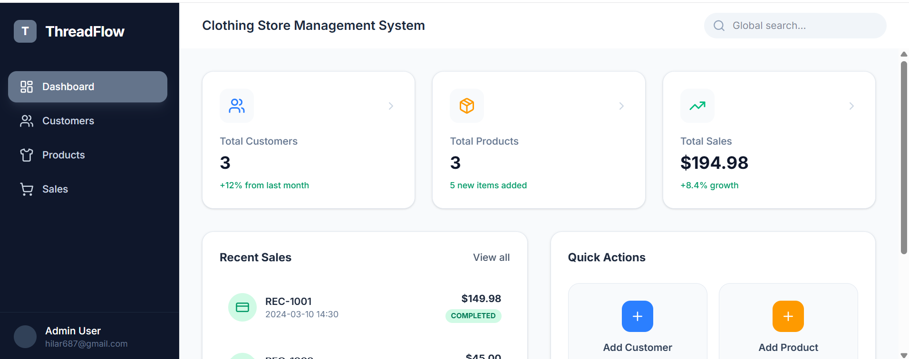

### Customer Management Screen
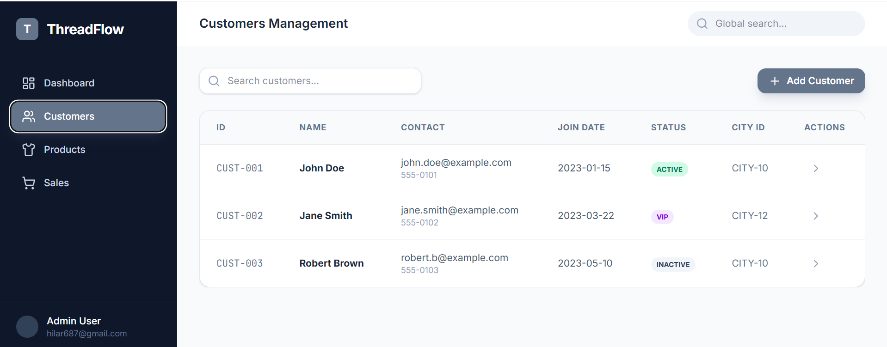
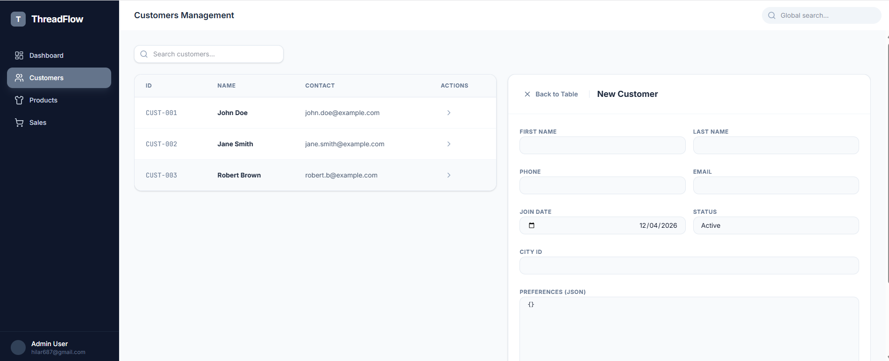

### Product Management Screen
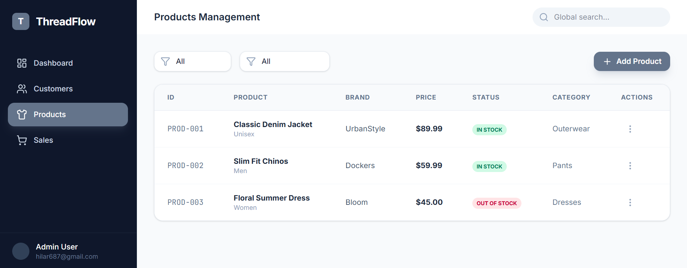

### Sales Management Screen
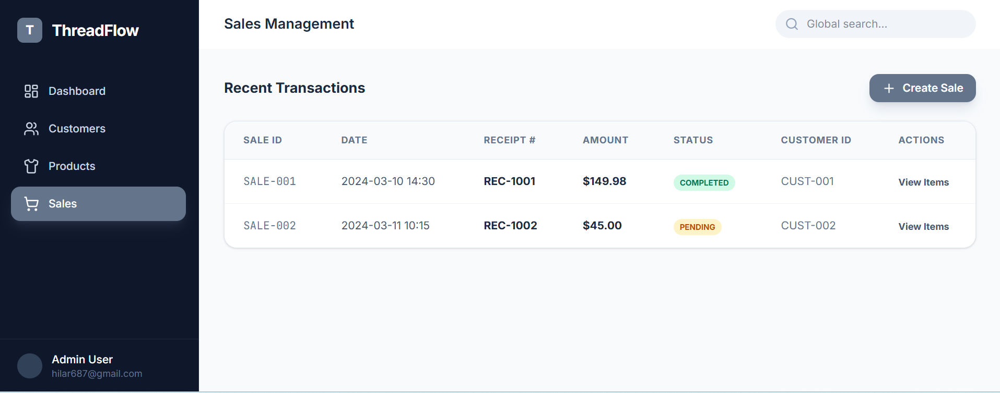

These mockups represent a conceptual view of the system and are intended to support the database design. The UI may be refined and expanded in later stages of the project.

---

## 3. ERD – Entity Relationship Diagram

The database design was created using **ERDPlus**.

The ERD models the main entities of a clothing retail management system and the relationships between them.

Main entities include:

- Branch
- Employee
- Customer
- Supplier
- Product
- Inventory
- Sale
- SaleItem

Each entity contains at least five attributes according to the project requirements.

Relationships include:

- Branch employs Employees
- Branch records Sales
- Branch stores Inventory
- Supplier supplies Products
- Product appears in Inventory
- Customer makes Sales
- Employee handles Sales
- Sale contains SaleItems
- SaleItem references Inventory

Cardinality constraints were defined for all relationships.

### ERD Diagram 

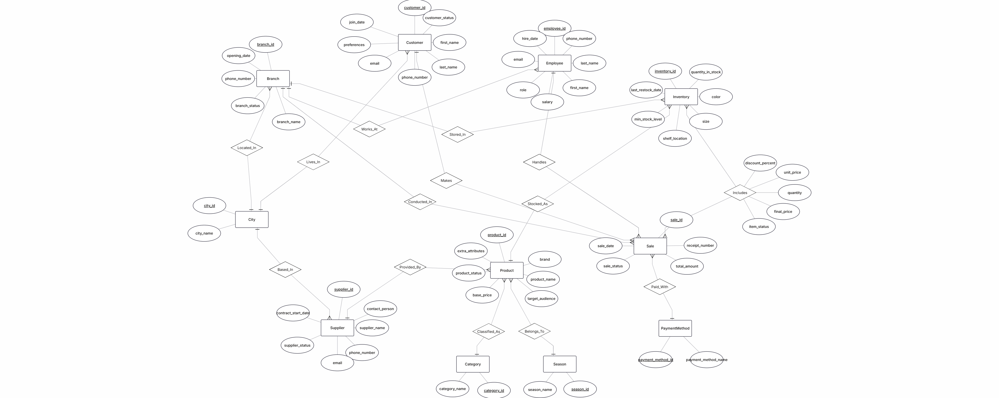
---

## 4. Relational Schema & DSD

The ERD was translated into a relational schema and implemented in PostgreSQL.

Each entity and relationship was mapped into tables according to standard database design principles.

The following diagram presents the database schema (DSD) as implemented in pgAdmin, including all tables, primary keys, and foreign key relationships:

### DSD Diagram erdplus

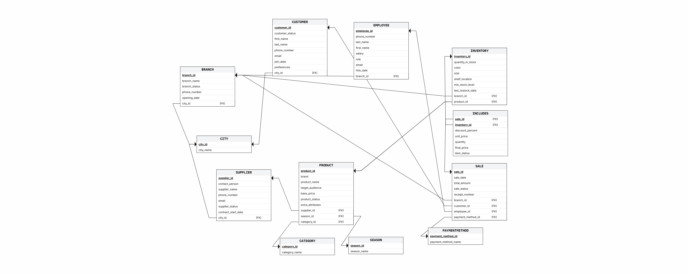

### ERD Diagram pgAdmin

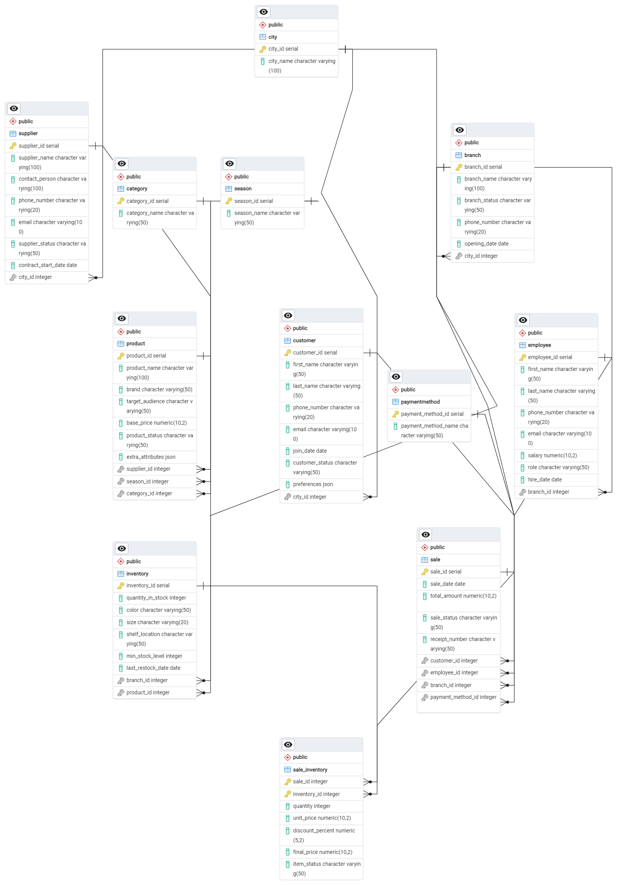

---

## 5. Design Decisions

Several design decisions were made during the design of the database in order to ensure that the system would be realistic, scalable, and well-structured.

First, the database was designed around the main business processes of a clothing retail chain: product management, inventory tracking, sales, suppliers, employees, customers, and branch activity. The selected entities reflect the core operations of the system and allow future expansion in later project stages.

In addition, some supporting dictionary tables, such as City, Season, Category, and PaymentMethod, were kept relatively small, since they represent fixed reference data rather than large transactional data. For this reason, these tables naturally contain fewer rows than the main operational tables.

Two JSON attributes were included in the schema in order to support flexible and dynamic data that may vary between records. This decision allows the system to store additional information without changing the relational structure whenever small variations are needed.

Significant DATE attributes were implemented across key entities (such as sale_date, hire_date, and contract_start_date) to accurately track temporal data.

Different data population methods were also chosen according to the nature of each table. Smaller and more controlled tables were populated manually through CSV files, larger tables with realistic synthetic data were generated using Mockaroo, and additional programmatic generation was performed using Python. This combination made it possible to balance control, realism, and efficiency.

Finally, larger volumes of data were assigned mainly to the central business tables in order to better simulate a real retail environment and support future querying, testing, and validation tasks.

---

## 6. Normalization & Functional Dependencies

All relations in the database were analyzed and normalized to at least Third Normal Form (3NF), in order to reduce redundancy and prevent update anomalies.

Functional dependencies were defined for each table based on their primary keys and relationships.

Examples of functional dependencies in the system:

- city_id → city_name  

- branch_id → branch_name, branch_status, phone_number, opening_date, city_id  

- supplier_id → supplier_name, contact_person, phone_number, email, supplier_status, contract_start_date, city_id  

- category_id → category_name  
- season_id → season_name  

- product_id → product_name, brand, target_audience, base_price, product_status, extra_attributes, supplier_id, season_id, category_id  

- customer_id → first_name, last_name, phone_number, email, join_date, customer_status, preferences, city_id  

- employee_id → first_name, last_name, phone_number, email, salary, role, hire_date, branch_id  

- inventory_id → quantity_in_stock, color, size, shelf_location, min_stock_level, last_restock_date, branch_id, product_id  

- sale_id → sale_date, total_amount, sale_status, receipt_number, customer_id, employee_id, branch_id, payment_method_id  

- payment_method_id → payment_method_name  

For the associative table:

- (sale_id, inventory_id) → quantity, unit_price, discount_percent, final_price, item_status  

Each table was designed so that all non-key attributes depend only on the primary key, with no partial or transitive dependencies.

All relations are in at least Third Normal Form (3NF), and most also satisfy Boyce-Codd Normal Form (BCNF), since every determinant is a candidate key.

This normalization ensures:

- elimination of redundant data  
- improved data consistency  
- prevention of insertion, update, and deletion anomalies  

As a result, the database schema is well-structured, efficient, and suitable for scalable system development.

---

## 7. Database Implementation

The database was implemented using PostgreSQL through pgAdmin.

The schema was created using the file:

- createTables.sql

Additional supporting scripts include:

- insertTables.sql - inserts the data to the tables
- dropTables.sql – removes all tables in the correct dependency order
- selectAll.sql – used to retrieve and validate data from all tables

---

## 8. Data Population

The database was populated using a combination of three different methods, as required by the project instructions. Each method was selected based on the characteristics of the data and the level of control or automation needed.

---

### 1. CSV / Excel Import

Several tables were populated using manually created CSV files.

These files were prepared using Excel and imported into PostgreSQL via pgAdmin.

Tables populated using this method:

- City  
- Season  
- Category  
- PaymentMethod  
- Branch  

This approach allowed precise control over the data and ensured consistency for structured and relatively small datasets.

---

### 2. External Data Generation (Mockaroo)

Mockaroo was used to generate realistic synthetic data for larger and more dynamic tables.

Tables populated using Mockaroo:

- Customer  
- Supplier  
- Employee  

Mockaroo enabled the creation of large datasets with realistic attributes such as names, emails, phone numbers, and dates.

Additionally, some fields were configured to include random NULL values, as required by the project guidelines.

---

### 3. Programmatic Data Generation (Python)

A Python script was used to generate SQL INSERT statements programmatically.

These statements were then executed in PostgreSQL in order to populate additional tables.

This method enabled efficient creation of large datasets while maintaining control over relationships and data consistency.

Tables populated using this method: Sale, Sale_Inventory (Sale Items), Product, and Inventory.

---

### 4. Manual SQL INSERT Statements

In addition to automated methods, manual SQL INSERT statements were used for selected small dictionary tables.

These inserts were executed directly through pgAdmin.

This approach demonstrates direct interaction with the database using SQL and provides full control over specific data values when needed.

---

### Data Volume & Characteristics

- Multiple tables contain at least 500 records, as required  
- The Sale and Sale_Inventory tables contain massive datasets of over 20,000 records each, generated via the Python script to simulate a high-volume retail environment.  
- Dictionary tables contain fewer records, as they represent static reference data  
- Random NULL values were included in optional fields  
- Data was generated to maintain referential integrity between tables

### Screenshots

#### CSV Import
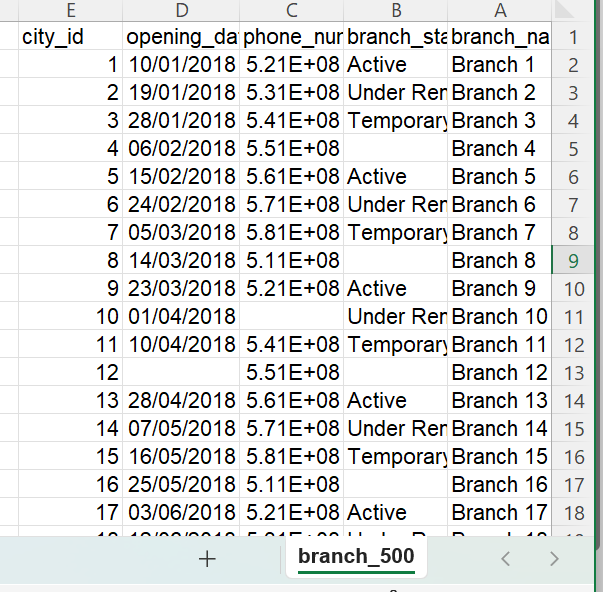

#### Mockaroo Data Generation
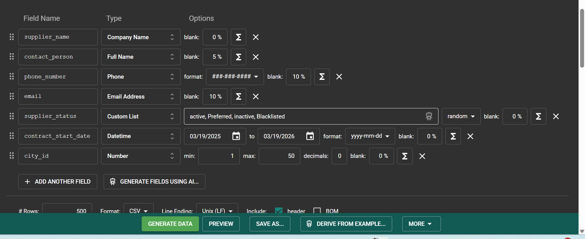

#### Python Data Generation
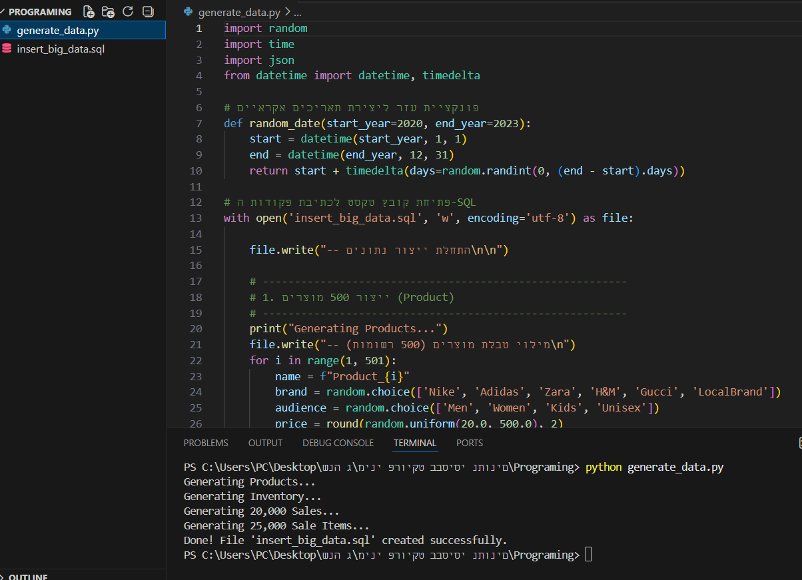

#### Manual SQL INSERT
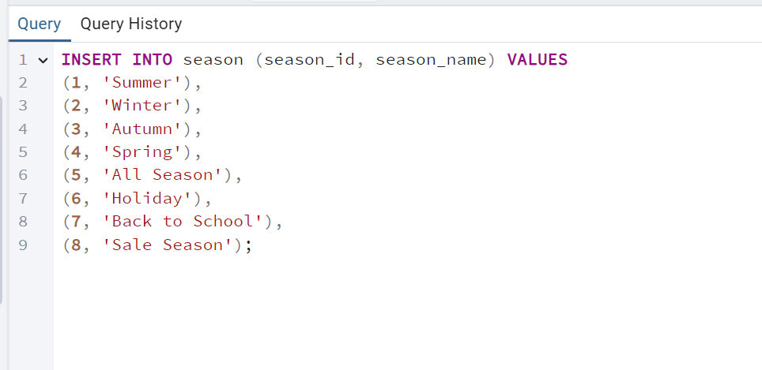

---

## 9. Backup & Recovery

A full backup of the database was created using pgAdmin’s built-in backup tool.

The backup was performed after the database schema had been fully created and populated with data, in order to ensure that both the database structure and its contents were preserved.

The backup file includes:

- All database tables
- Primary and foreign key constraints
- The stored data inserted into the tables

The backup was saved in a dedicated backup file:

- `backup_2026-03-21.backup`

To verify that the backup was valid and usable, a restoration test was performed on a separate database instance.

During the restore process, the backup file was loaded into a new database, and the restored system was checked to confirm that:

- all tables were recreated successfully
- the relationships between tables were preserved
- the data was restored correctly
- the database could be queried without errors

This process confirmed that the backup is valid and that the system can be reconstructed from the backup file if needed.

The backup and restore process is an important part of the project, since it ensures database reliability, recoverability, and protection against data loss.

### Backup Process

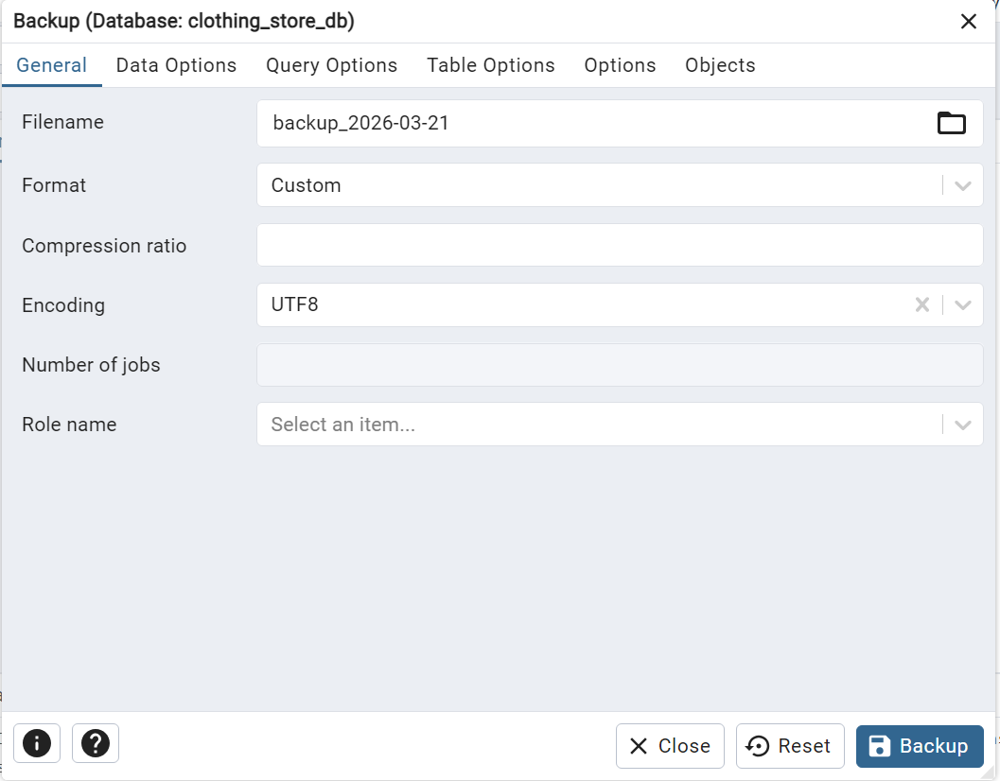

### Restore Process

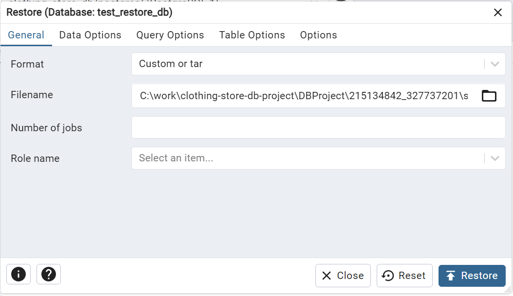

---

## How to Run the Project

1. Run createTables.sql
2. Run insertTables.sql
3. Use selectAll.sql to verify the data
4. Alternatively, restore the database using the backup file

