# Project Details

**System:** Clothing Store Management System
**Selected Unit:** Sales & Retail Operations

**Team Members:**

* Hila Miller
* Hila Rosental

**Institution:** Jerusalem College of Technology (JCT)

This document presents **Stage 2** of the Database Systems course project.

In this stage, the database was queried and extended using advanced SQL operations, including:

* 8 non-trivial SELECT queries (including two pairs of equivalent queries)
* 3 UPDATE queries
* 3 DELETE queries
* 3 constraints added using ALTER TABLE
* transaction management using ROLLBACK and COMMIT
* query optimization using indexes

Each part of the stage was implemented according to the project requirements and includes SQL code, execution screenshots, and explanations.

The goal of this stage was not only to retrieve information from the database, but also to demonstrate understanding of SQL logic, data integrity, transaction management, and query efficiency. The queries were designed to support realistic business needs of the clothing retail management system and to match the future GUI screens of the project.

---

# Table of Contents

1. [Stage 2 Overview](#1-stage-2--queries-constraints-transactions-and-optimization)
2. [SELECT Queries](#2-select-queries)
3. [UPDATE Queries](#3-update-queries)
4. [DELETE Queries](#4-delete-queries)
5. [Constraints](#5-constraints)
6. [Transaction Management – ROLLBACK and COMMIT](#6-transaction-management--rollback-and-commit)
7. [Indexes and Query Optimization](#7-indexes-and-query-optimization)
8. [Stage 2 Files](#8-stage-2-files)](#17-stage-2-files)

---

# Stage 2 – Queries, Constraints, Transactions, and Optimization

## 1. Stage 2 – Queries, Constraints, Transactions, and Optimization – Queries, Constraints, Transactions, and Optimization

In this stage, the database designed in Stage 1 was queried and improved using SQL.

The work in this stage included:

* writing 8 non-trivial `SELECT` queries
* writing 3 `UPDATE` queries
* writing 3 `DELETE` queries
* adding 3 new constraints using `ALTER TABLE`
* demonstrating `ROLLBACK` and `COMMIT`
* adding indexes and comparing query performance before and after indexing

The queries were designed to support realistic management scenarios in the clothing retail system, such as analyzing branch performance, identifying best-selling products, detecting inactive customers, and locating products that were not sold during a selected period.

In addition, several integrity constraints were added in order to improve data validity, and transaction control was demonstrated in order to show how database changes can be either saved permanently or reverted safely.

---

## 2. SELECT Queries

### Query 1 – Sales Summary per Branch in a Date Range

This query presents, for each branch, the number of sales and the total sales amount within a selected date range.
It is intended for a management dashboard that compares branch performance over time.

```sql
SELECT
    b.branch_id,
    b.branch_name,
    COUNT(s.sale_id) AS number_of_sales,
    SUM(s.total_amount) AS total_sales_amount
FROM branch b
JOIN sale s
    ON b.branch_id = s.branch_id
WHERE s.sale_date BETWEEN '2024-01-01' AND '2024-12-31'
GROUP BY b.branch_id, b.branch_name
ORDER BY total_sales_amount DESC;
```

#### Query Result

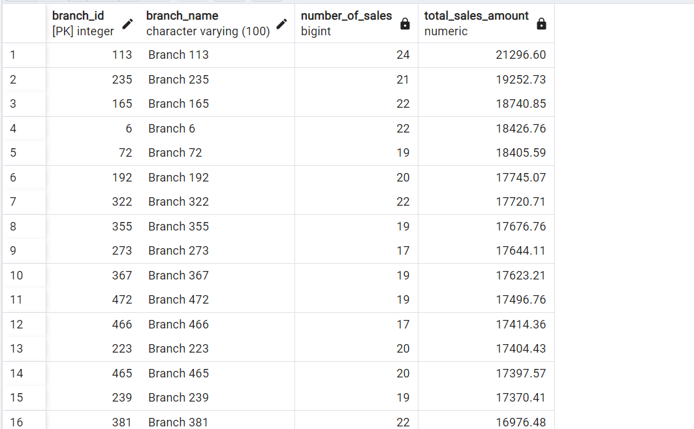

---

### Query 2 – Best-Selling Products by Quantity

This query identifies the products that were sold in the largest quantities.
For each product, it displays the product ID, product name, brand, and total quantity sold.

The implementation follows the actual physical schema of the database. Since sales are linked to `inventory`, and each inventory record is linked to a product, the query joins `product`, `inventory`, and `sale_inventory`.

```sql
SELECT
    p.product_id,
    p.product_name,
    p.brand,
    SUM(si.quantity) AS total_quantity_sold
FROM product p
JOIN inventory i
    ON p.product_id = i.product_id
JOIN sale_inventory si
    ON i.inventory_id = si.inventory_id
GROUP BY p.product_id, p.product_name, p.brand
ORDER BY total_quantity_sold DESC;
```

#### Query Result

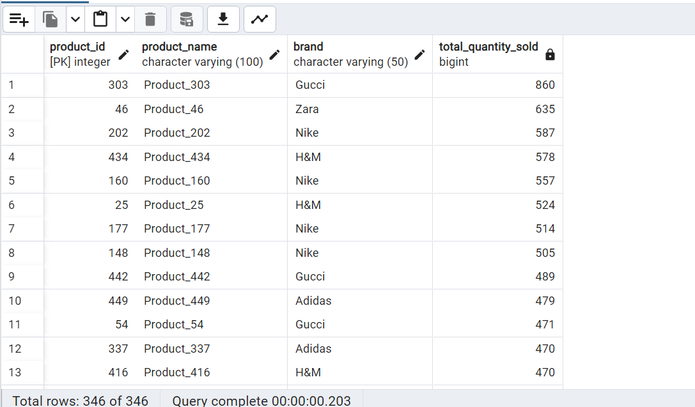

---

### Query 3A – Customers Who Spent the Most Money (JOIN + GROUP BY)

This query calculates the total amount spent by each customer, based on all sales associated with that customer.
The result is sorted from the customer who spent the most to the one who spent the least.

This version uses a `JOIN` between `customer` and `sale`, followed by `GROUP BY`.

```sql
SELECT
    c.customer_id,
    c.first_name,
    c.last_name,
    SUM(s.total_amount) AS total_spent
FROM customer c
JOIN sale s
    ON c.customer_id = s.customer_id
GROUP BY c.customer_id, c.first_name, c.last_name
ORDER BY total_spent DESC;
```

#### Query 3A Execution

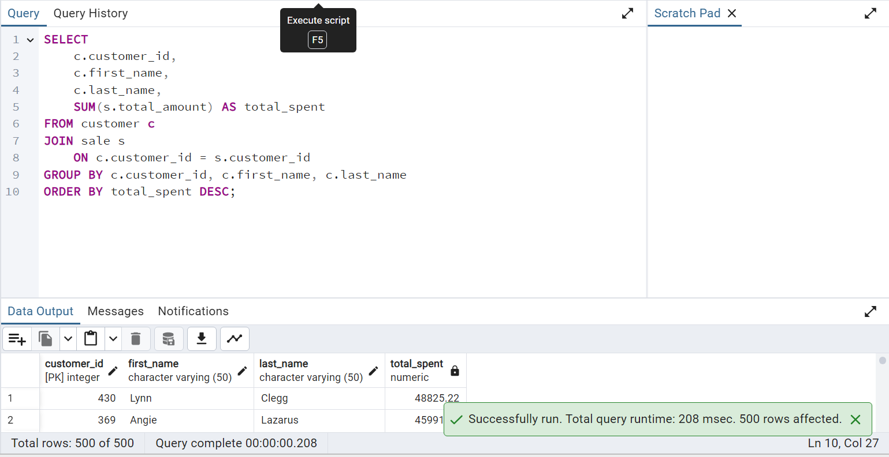

#### Query 3A Result

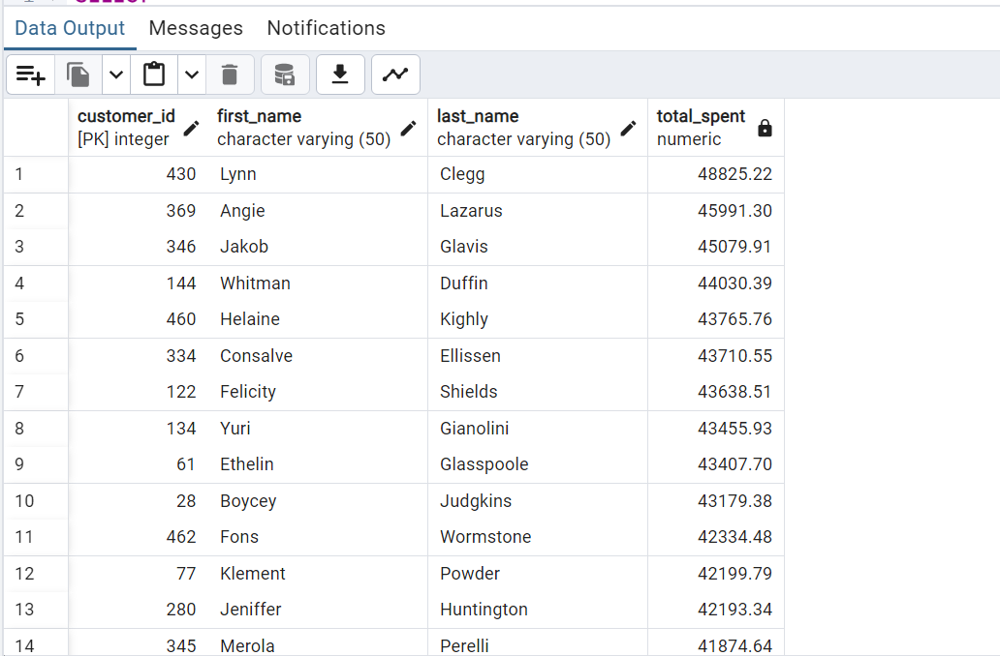

---

### Query 3B – Customers Who Spent the Most Money (Correlated Subquery)

This query returns the same logical result as Query 3A, but uses a correlated subquery instead of `JOIN + GROUP BY`.

For each customer, the subquery calculates the sum of all related sales.
The `EXISTS` clause is used to ensure that only customers with at least one sale are included.

```sql
SELECT
    c.customer_id,
    c.first_name,
    c.last_name,
    (
        SELECT SUM(s.total_amount)
        FROM sale s
        WHERE s.customer_id = c.customer_id
    ) AS total_spent
FROM customer c
WHERE EXISTS (
    SELECT 1
    FROM sale s
    WHERE s.customer_id = c.customer_id
)
ORDER BY total_spent DESC;
```

#### Query 3B Execution

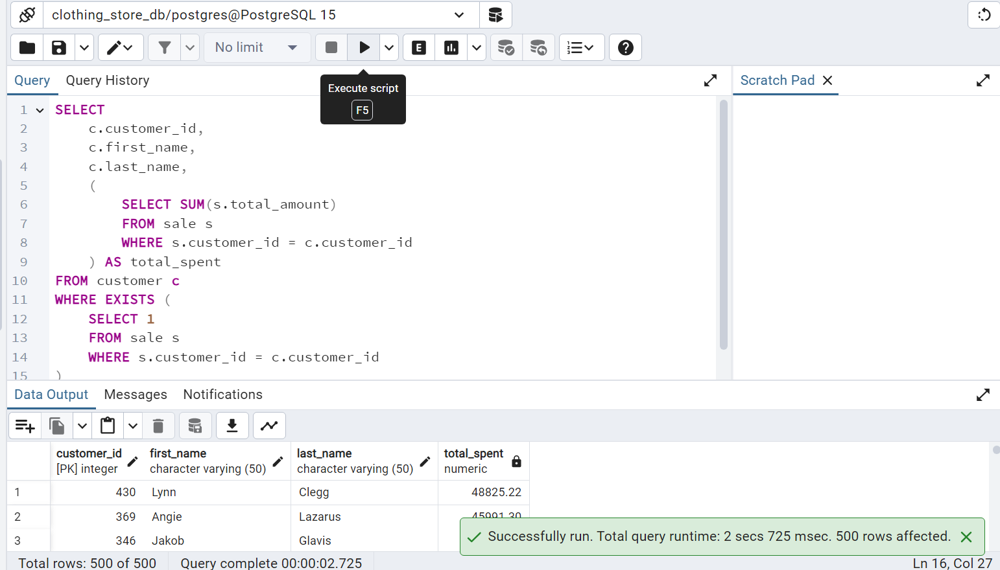

#### Query 3B Result

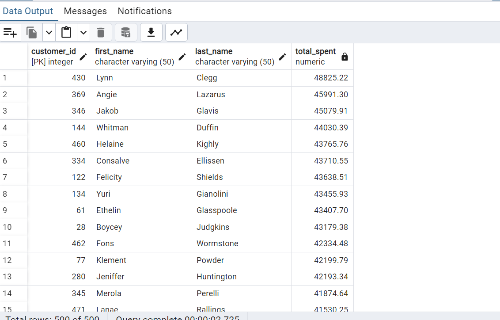

#### Comparison Between Query 3A and Query 3B

Both queries return the same result: the total amount spent by each customer.

However, Query 3A is generally more efficient because it processes the data in a set-oriented way using a single `JOIN` and a single `GROUP BY` operation.
Query 3B uses a correlated subquery, which may execute the inner aggregation separately for each customer and therefore may require more work when the number of customers is large.

For this reason, the `JOIN + GROUP BY` solution is usually preferred for performance and scalability, while the correlated subquery version is useful for demonstrating an alternative SQL approach.

---

### Query 4A – Products Not Sold in a Selected Date Range (NOT EXISTS)

This query returns products that were not sold during the year 2024.

The query is based on the actual schema of the system and checks whether a product has any matching sale, through the chain:
`product -> inventory -> sale_inventory -> sale`.

This version uses `NOT EXISTS`.

```sql
SELECT
    p.product_id,
    p.product_name,
    p.brand
FROM product p
WHERE NOT EXISTS (
    SELECT 1
    FROM inventory i
    JOIN sale_inventory si
        ON i.inventory_id = si.inventory_id
    JOIN sale s
        ON si.sale_id = s.sale_id
    WHERE i.product_id = p.product_id
      AND s.sale_date BETWEEN '2024-01-01' AND '2024-12-31'
)
ORDER BY p.product_id;
```

#### Query 4A Execution

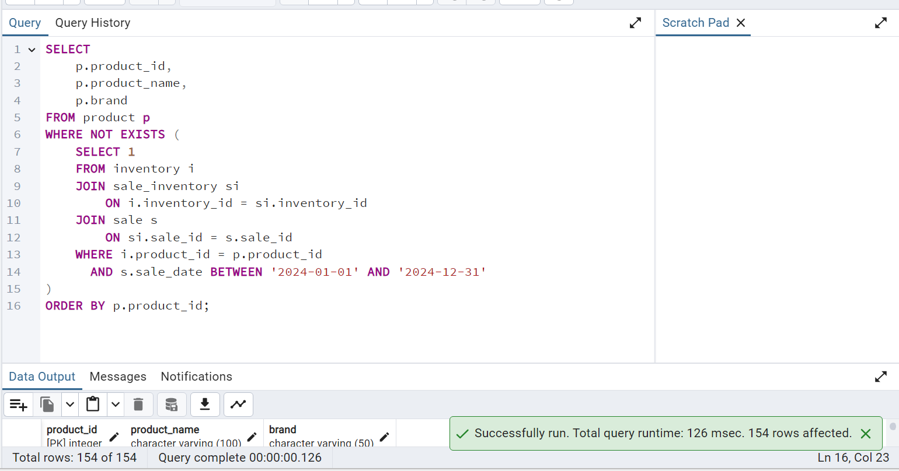

#### Query 4A Result

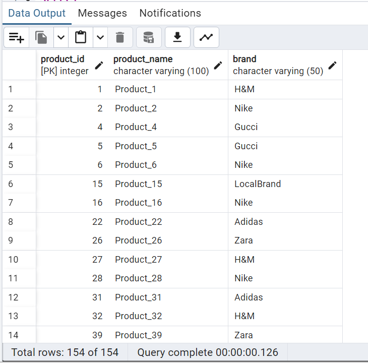

---

### Query 4B – Products Not Sold in a Selected Date Range (LEFT JOIN + IS NULL)

This query returns the same logical result as Query 4A, but uses `LEFT JOIN` and `IS NULL`.

The condition on `sale_date` is placed inside the `ON` clause of the final `LEFT JOIN`, in order to preserve rows without matching sales.
This is an important logical detail: placing the date condition in the `WHERE` clause would eliminate the `NULL` rows and break the intended meaning of the query.

```sql
SELECT
    p.product_id,
    p.product_name,
    p.brand
FROM product p
LEFT JOIN inventory i
    ON p.product_id = i.product_id
LEFT JOIN sale_inventory si
    ON i.inventory_id = si.inventory_id
LEFT JOIN sale s
    ON si.sale_id = s.sale_id
   AND s.sale_date BETWEEN '2024-01-01' AND '2024-12-31'
WHERE s.sale_id IS NULL
ORDER BY p.product_id;
```

#### Query 4B Execution

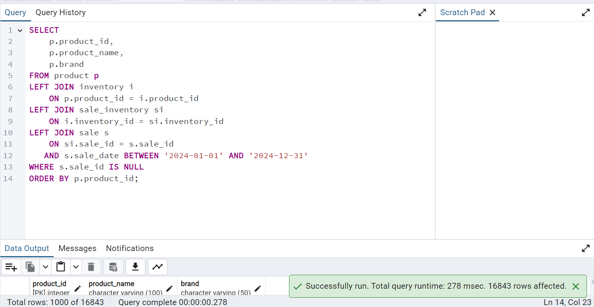

#### Query 4B Result

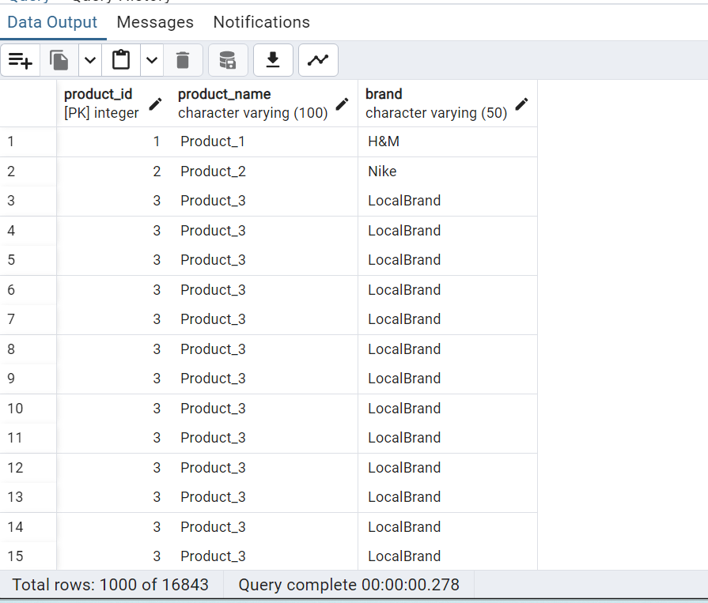

#### Comparison Between Query 4A and Query 4B

Both queries return products that were not sold during the selected date range.

The `NOT EXISTS` version expresses the logic in a direct way: return products for which no matching sale exists.
The `LEFT JOIN + IS NULL` version works by attempting to join matching sales and then filtering products for which no match was found.

Although both are valid, the `NOT EXISTS` version is usually clearer and less error-prone for this type of logic.
The `LEFT JOIN` version requires greater care, especially regarding the placement of filtering conditions inside `ON` rather than `WHERE`.

---

### Query 5 – Low Inventory Report for Goods Order

This query identifies inventory items that are below their minimum stock level.  
For each inventory record, it returns the product name, current quantity in stock, minimum required stock level, and the branch in which the item is located.

This query is useful for operational management, as it helps identify products that require restocking and supports decision-making for supplier orders.

~~~sql
SELECT 
    p.product_name, 
    i.quantity_in_stock, 
    i.min_stock_level, 
    b.branch_name
FROM Inventory i
JOIN Product p ON i.product_id = p.product_id
JOIN Branch b ON i.branch_id = b.branch_id
WHERE i.quantity_in_stock < i.min_stock_level
ORDER BY i.quantity_in_stock ASC;
~~~

#### Query Result

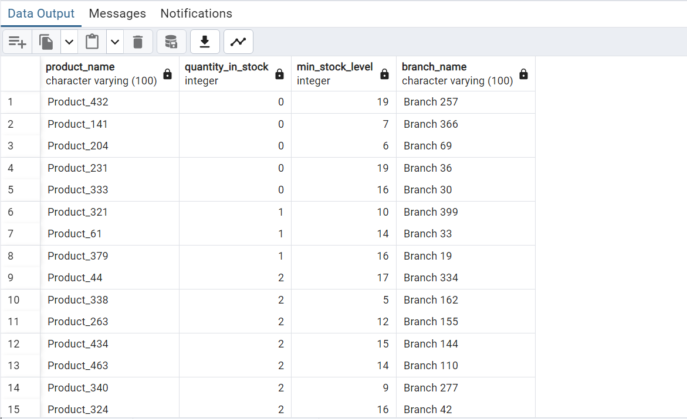

---

### Query 6 – Active Suppliers and Their Products

This query retrieves all active suppliers along with the products they supply.  
For each supplier, the query returns the supplier name, product name, and contract start date.

This query demonstrates the relationship between suppliers and products and is useful for tracking supplier activity and product sourcing.

~~~sql
SELECT 
    s.supplier_name, 
    p.product_name, 
    s.contract_start_date
FROM Supplier s
JOIN Product p ON s.supplier_id = p.supplier_id
WHERE s.supplier_status = 'active'
ORDER BY s.contract_start_date DESC;
~~~

#### Query Result

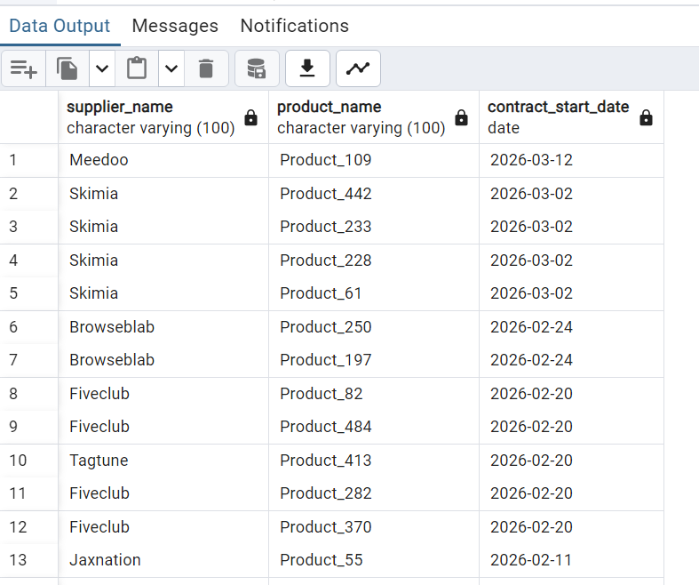

---

### Query 7A – Customers Who Did Not Purchase in a Recent Period (NOT EXISTS)

This query identifies customers who did not make any purchases after a selected date.  
It returns the customer’s first name, last name, and join date.

This version uses `NOT EXISTS` to check the absence of sales records in the specified time period.

~~~sql
SELECT c.first_name, c.last_name, c.join_date
FROM Customer c
WHERE NOT EXISTS (
    SELECT 1 
    FROM Sale s 
    WHERE s.customer_id = c.customer_id 
      AND s.sale_date > '2024-11-01'
);
~~~

#### Query 7A Execution

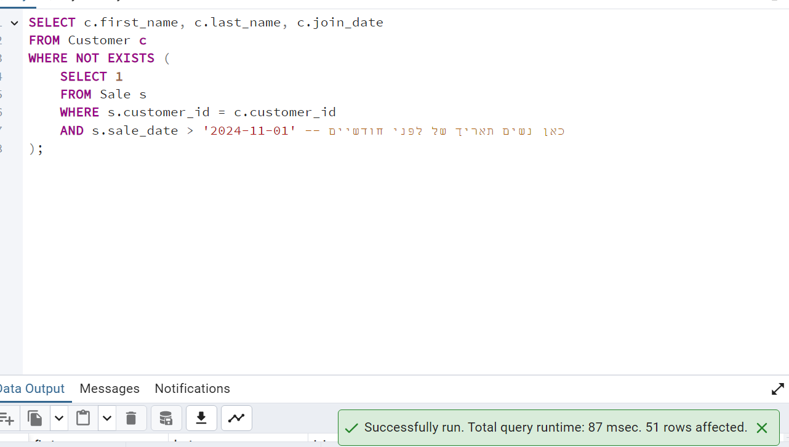

#### Query 7A Result

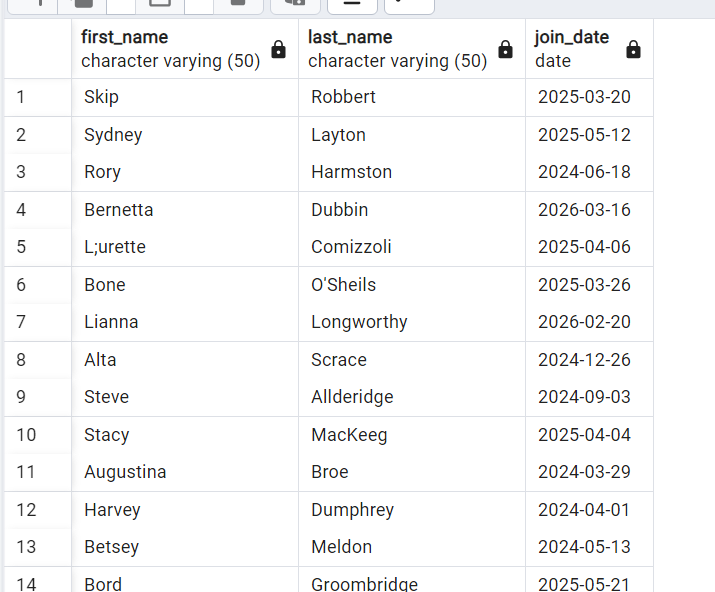

---

### Query 7B – Customers Who Did Not Purchase in a Recent Period (LEFT JOIN + IS NULL)

This query returns the same logical result as Query 7A, but uses a different SQL approach.

Instead of checking for non-existence, it attempts to join recent sales and filters customers for whom no matching records were found using `IS NULL`.

~~~sql
SELECT c.first_name, c.last_name, c.join_date
FROM Customer c
LEFT JOIN Sale s 
    ON c.customer_id = s.customer_id 
   AND s.sale_date > '2024-11-01'
WHERE s.sale_id IS NULL;
~~~

#### Query 7B Execution

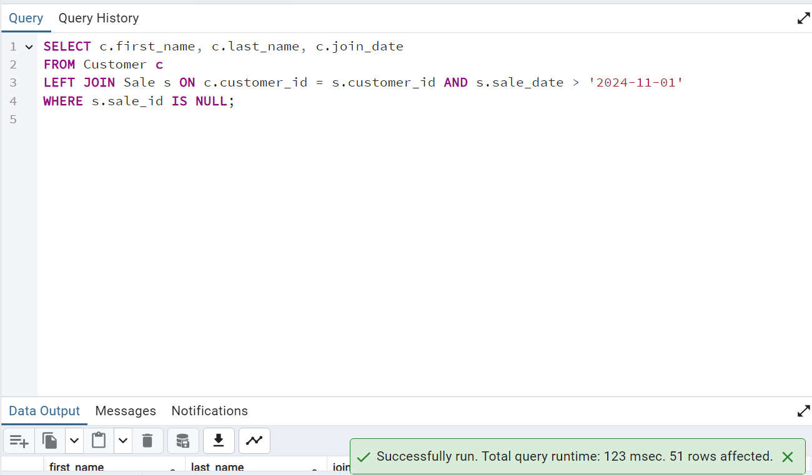

#### Query 7B Result

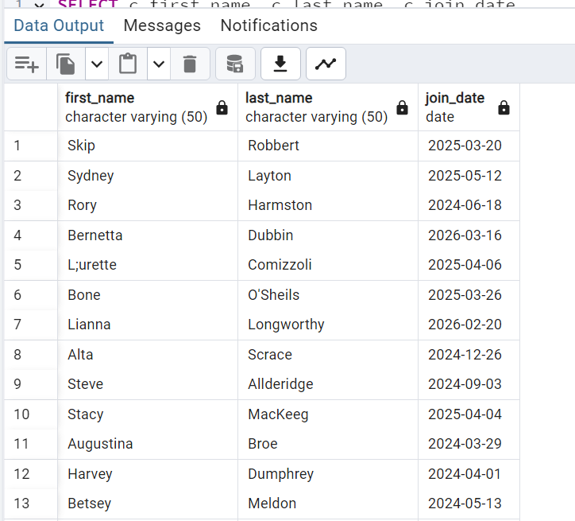

#### Comparison Between Query 7A and Query 7B

Both queries return customers who have not made any purchases after the selected date.

- Query 7A uses `NOT EXISTS`, which directly checks for the absence of matching records.
- Query 7B uses `LEFT JOIN` and filters rows where no matching records were found using `IS NULL`.

The `NOT EXISTS` approach is generally clearer and less prone to logical errors, while the `LEFT JOIN` approach requires careful placement of conditions inside the `ON` clause.

---

### Query 8A – Branches with the Highest Number of Sales (GROUP BY)

This query retrieves the branches with the highest number of sales.  
It groups sales by branch and counts the number of sales per branch, returning the top 5 branches with the highest sales volume.

This query is useful for identifying high-performing branches and supports business analysis and decision-making.

~~~sql
SELECT b.branch_name, COUNT(s.sale_id) AS total_sales
FROM Branch b
JOIN Sale s ON b.branch_id = s.branch_id
GROUP BY b.branch_name
ORDER BY total_sales DESC
LIMIT 5;
~~~

#### Query 8A Execution

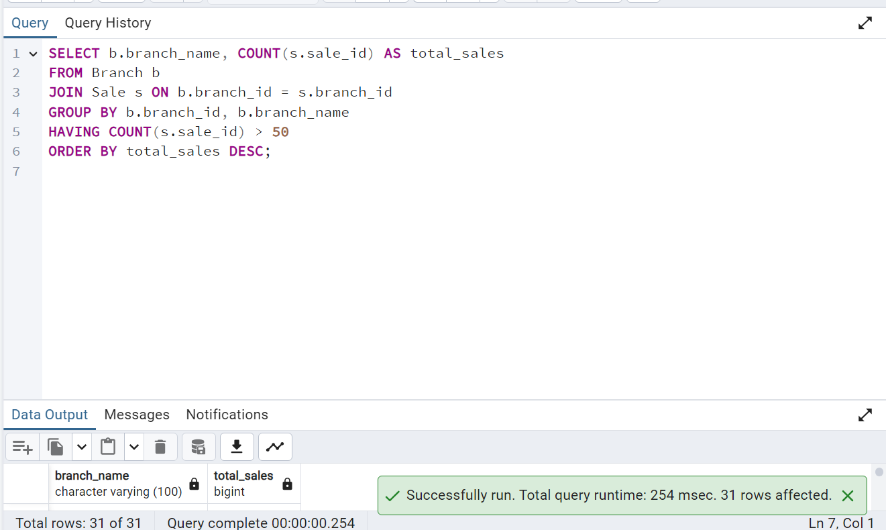

#### Query 8A Result

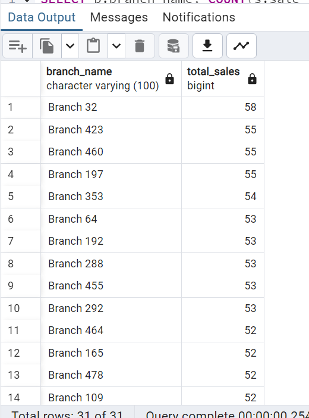

---

### Query 8B – Branches with the Highest Number of Sales (Subquery)

This query returns similar information to Query 8A, but uses a correlated subquery instead of `GROUP BY`.

For each branch, a subquery calculates the total number of sales.  
Only branches with more than 50 sales are included in the result.

~~~sql
SELECT b.branch_name, 
       (SELECT COUNT(*) 
        FROM Sale s 
        WHERE s.branch_id = b.branch_id) AS total_sales
FROM Branch b
WHERE (SELECT COUNT(*) 
       FROM Sale s 
       WHERE s.branch_id = b.branch_id) > 50
ORDER BY total_sales DESC;
~~~

#### Query 8B Execution

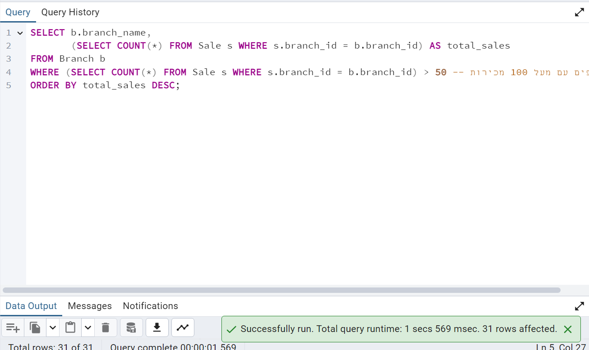

#### Query 8B Result

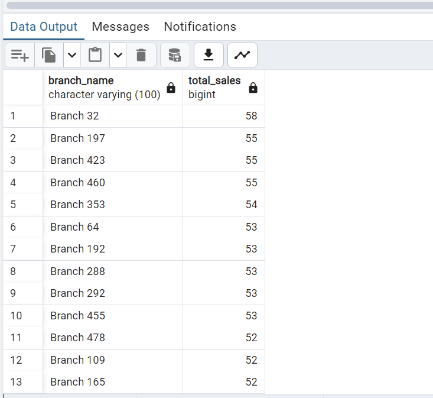

#### Comparison Between Query 8A and Query 8B

Both queries analyze branch performance based on the number of sales.

- Query 8A uses `GROUP BY`, which processes the data in a set-oriented manner and is generally more efficient.
- Query 8B uses a correlated subquery, which calculates the result separately for each branch and may be less efficient for large datasets.

The `GROUP BY` solution is typically preferred in real-world systems, while the subquery version demonstrates an alternative SQL approach.

---

## 3. UPDATE Queries

### UPDATE 1 – Apply Discount to Products with Very Low Sales Quantity

This update reduces the `base_price` by 10% for products whose total sold quantity is lower than a selected threshold.

The purpose of this update is to simulate a realistic business scenario in which products with weak sales performance are discounted in order to encourage future sales.

#### Before Update

```sql
SELECT
    p.product_id,
    p.base_price,
    SUM(si.quantity) AS total_sold
FROM product p
JOIN inventory i
    ON p.product_id = i.product_id
JOIN sale_inventory si
    ON i.inventory_id = si.inventory_id
GROUP BY p.product_id, p.base_price
HAVING SUM(si.quantity) < 80;
```

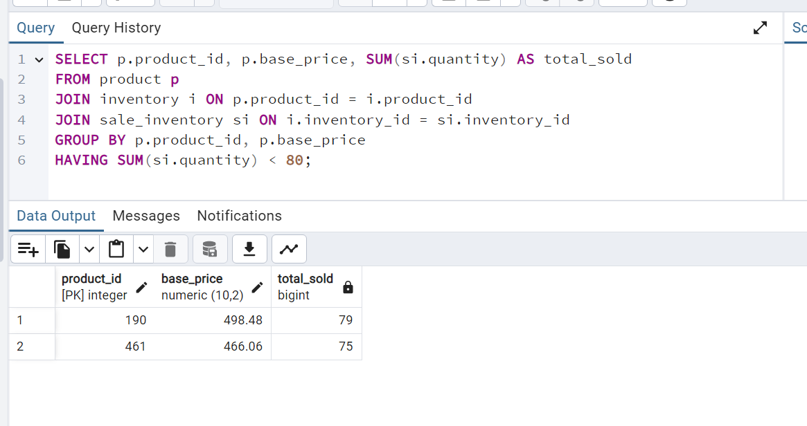

#### Update Statement

```sql
UPDATE product
SET base_price = base_price * 0.9
WHERE product_id IN (
    SELECT p.product_id
    FROM product p
    JOIN inventory i
        ON p.product_id = i.product_id
    JOIN sale_inventory si
        ON i.inventory_id = si.inventory_id
    GROUP BY p.product_id
    HAVING SUM(si.quantity) < 80
);
```

#### After Update

```sql
SELECT
    p.product_id,
    p.base_price,
    SUM(si.quantity) AS total_sold
FROM product p
JOIN inventory i
    ON p.product_id = i.product_id
JOIN sale_inventory si
    ON i.inventory_id = si.inventory_id
GROUP BY p.product_id, p.base_price
HAVING SUM(si.quantity) < 80;
```

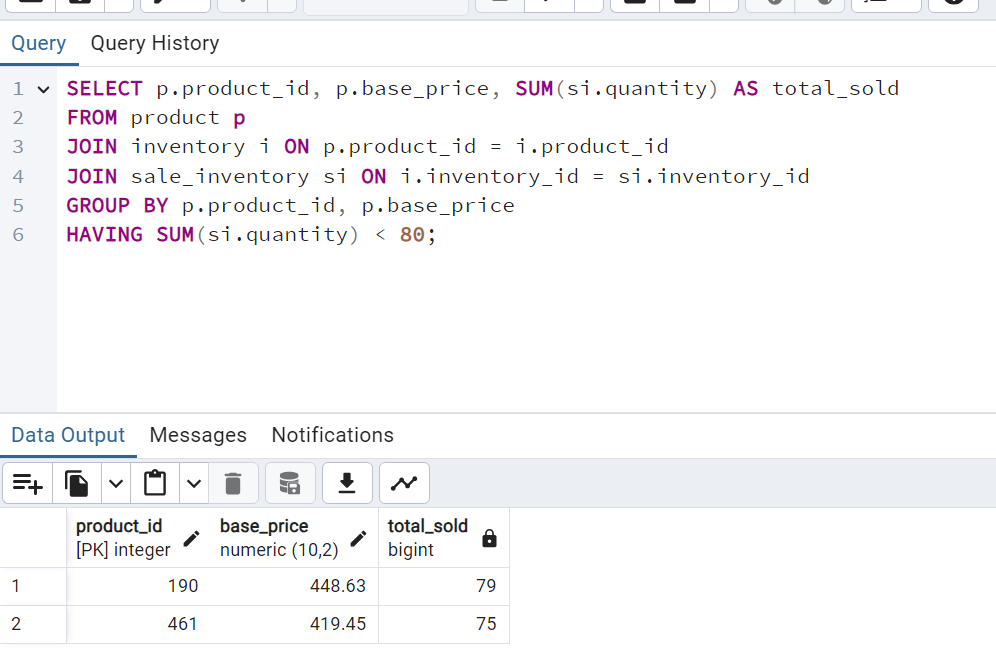

---

### UPDATE 2 – Mark Customers as Inactive if They Did Not Purchase Since a Selected Date

This update changes `customer_status` to `'inactive'` for customers who did not perform any purchase from `2024-08-05` onward.

This query demonstrates a realistic customer activity rule and uses a `NOT EXISTS` subquery with a date condition.

#### Before Update

```sql
SELECT
    c.customer_id,
    c.first_name,
    c.last_name,
    c.customer_status
FROM customer c
WHERE NOT EXISTS (
    SELECT 1
    FROM sale s
    WHERE s.customer_id = c.customer_id
      AND s.sale_date >= '2024-08-05'
);
```

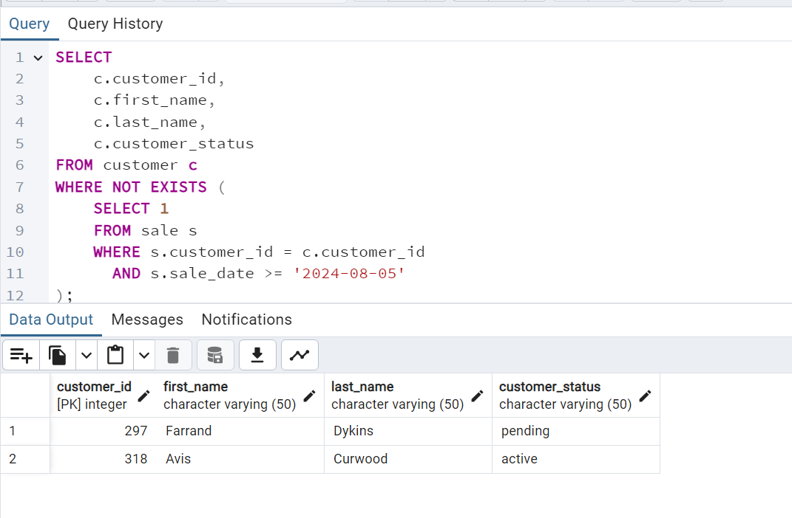

#### Update Statement

```sql
UPDATE customer
SET customer_status = 'inactive'
WHERE customer_id IN (
    SELECT c.customer_id
    FROM customer c
    WHERE NOT EXISTS (
        SELECT 1
        FROM sale s
        WHERE s.customer_id = c.customer_id
          AND s.sale_date >= '2024-08-05'
    )
);
```

#### After Update

```sql
SELECT
    c.customer_id,
    c.first_name,
    c.last_name,
    c.customer_status
FROM customer c
WHERE NOT EXISTS (
    SELECT 1
    FROM sale s
    WHERE s.customer_id = c.customer_id
      AND s.sale_date >= '2024-08-05'
);
```

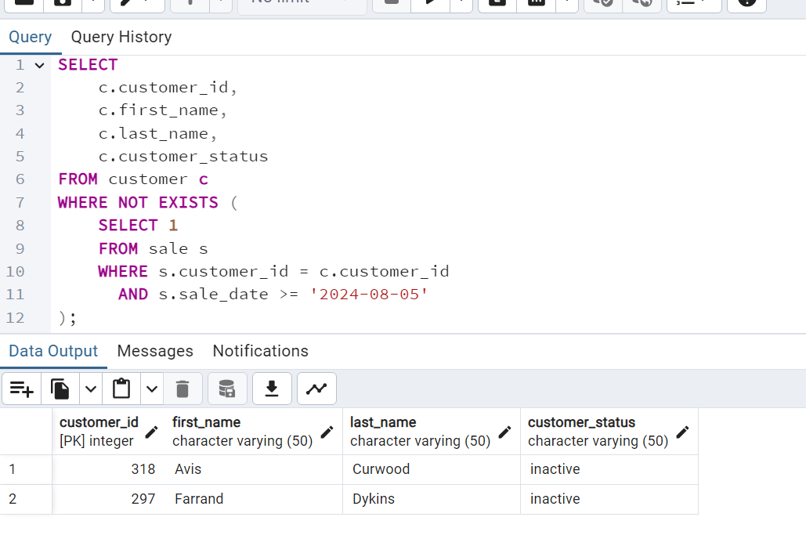

---

### UPDATE 3 – Increase Minimum Stock Level for High-Demand Products

This update increases `min_stock_level` by 5 for inventory records of products whose total sold quantity is greater than a selected threshold.

The purpose of this update is to support better inventory planning for high-demand products.

#### Before Update

```sql
SELECT
    i.inventory_id,
    i.product_id,
    i.branch_id,
    i.min_stock_level,
    sold_products.total_sold
FROM inventory i
JOIN (
    SELECT
        i2.product_id,
        SUM(si.quantity) AS total_sold
    FROM inventory i2
    JOIN sale_inventory si
        ON i2.inventory_id = si.inventory_id
    GROUP BY i2.product_id
    HAVING SUM(si.quantity) > 500
) AS sold_products
    ON i.product_id = sold_products.product_id
ORDER BY i.product_id, i.inventory_id;
```

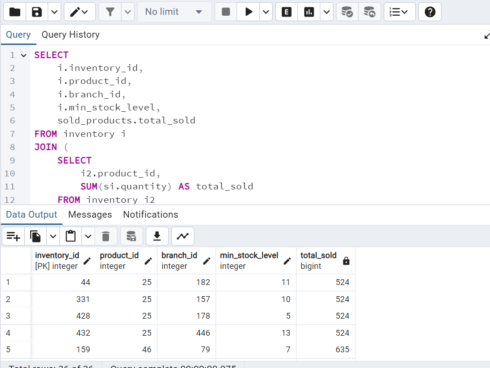

#### Update Statement

```sql
UPDATE inventory
SET min_stock_level = min_stock_level + 5
WHERE product_id IN (
    SELECT
        i.product_id
    FROM inventory i
    JOIN sale_inventory si
        ON i.inventory_id = si.inventory_id
    GROUP BY i.product_id
    HAVING SUM(si.quantity) > 500
);
```

#### After Update

```sql
SELECT
    i.inventory_id,
    i.product_id,
    i.branch_id,
    i.min_stock_level,
    sold_products.total_sold
FROM inventory i
JOIN (
    SELECT
        i2.product_id,
        SUM(si.quantity) AS total_sold
    FROM inventory i2
    JOIN sale_inventory si
        ON i2.inventory_id = si.inventory_id
    GROUP BY i2.product_id
    HAVING SUM(si.quantity) > 500
) AS sold_products
    ON i.product_id = sold_products.product_id
ORDER BY i.product_id, i.inventory_id;
```

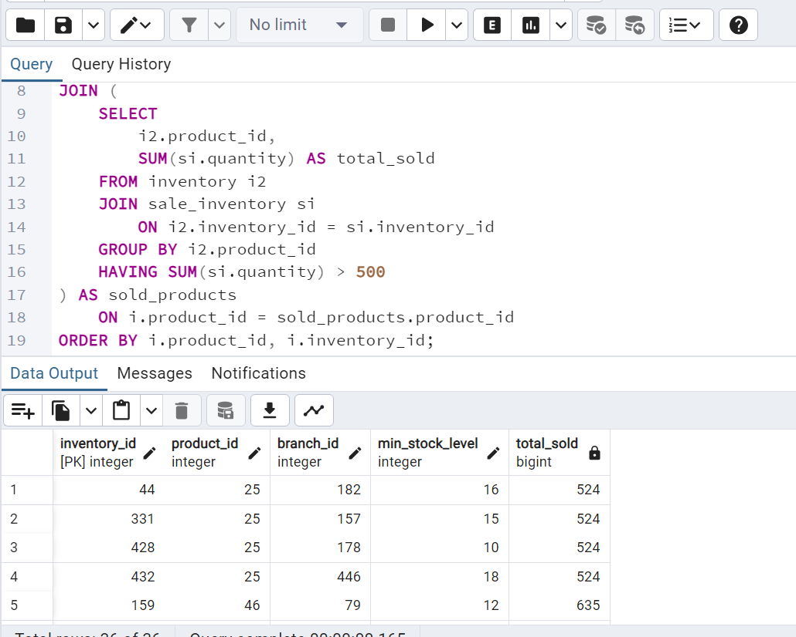

---

---

## 4. DELETE Queries

### DELETE 1 – Deleting Customers Without Any Purchases

This query deletes customers who have never made any purchases in the system.  
It uses a `NOT EXISTS` subquery to identify customers that are not associated with any records in the `sale` table.

The purpose of this query is to remove irrelevant customer records that have no activity in the system.

~~~sql
DELETE FROM customer c
WHERE c.email IN ('noa.levi24@example.com', 'daniel.cohen24@example.com')
  AND NOT EXISTS (
      SELECT 1
      FROM sale s
      WHERE s.customer_id = c.customer_id
  );
~~~

#### Before Deletion

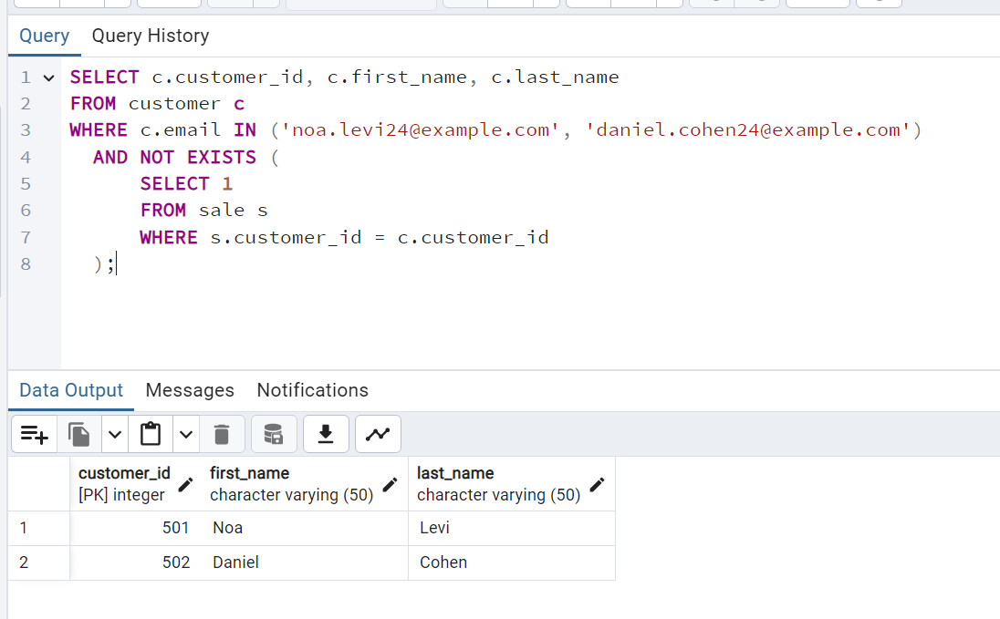

#### After Deletion

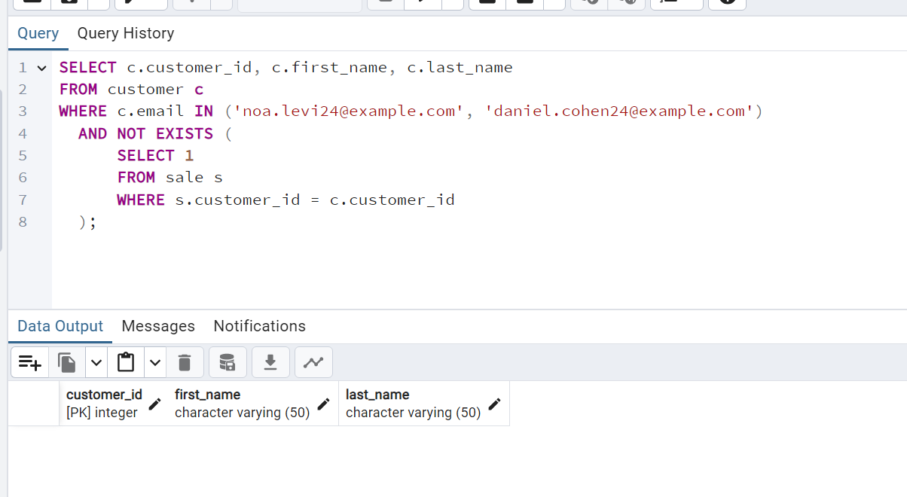

---

### DELETE 2 – Deleting Inventory Records with Zero Stock and No Sales

This query deletes inventory records where the stock quantity is zero and the item has never appeared in any sale.  
It ensures that only unused inventory records are removed.

The query uses a `NOT EXISTS` condition to verify that the inventory item is not referenced in the `sale_inventory` table.

~~~sql
DELETE FROM inventory i
WHERE i.quantity_in_stock = 0
  AND NOT EXISTS (
      SELECT 1
      FROM sale_inventory si
      WHERE si.inventory_id = i.inventory_id
  );
~~~

#### Before Deletion

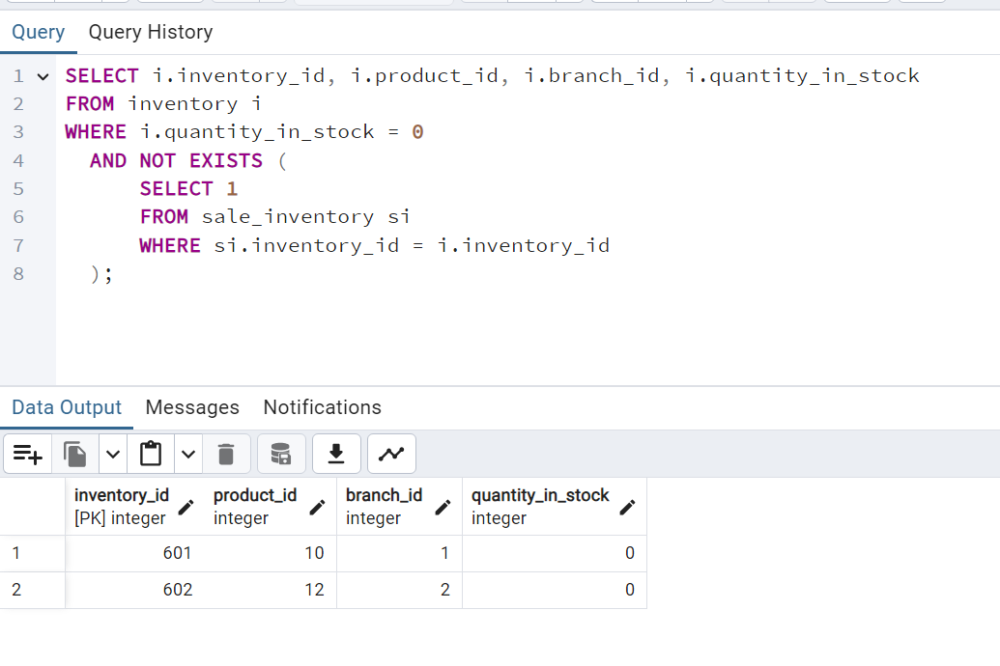

#### After Deletion

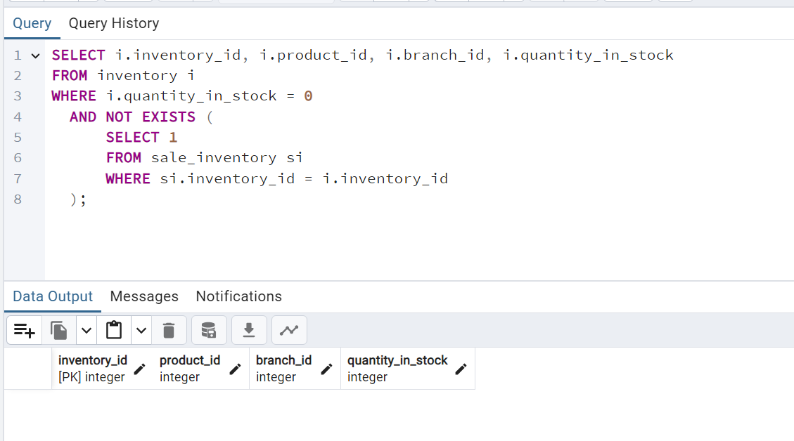

---

### DELETE 3 – Deleting Inactive Suppliers Without Associated Products

This query deletes suppliers whose status is `inactive` and who are not associated with any products in the system.

The purpose of this query is to clean up supplier records that are no longer relevant.

~~~sql
DELETE FROM supplier s
WHERE s.supplier_status = 'inactive'
  AND NOT EXISTS (
      SELECT 1
      FROM product p
      WHERE p.supplier_id = s.supplier_id
  )
	AND supplier_id < 60;
~~~

#### Before Deletion

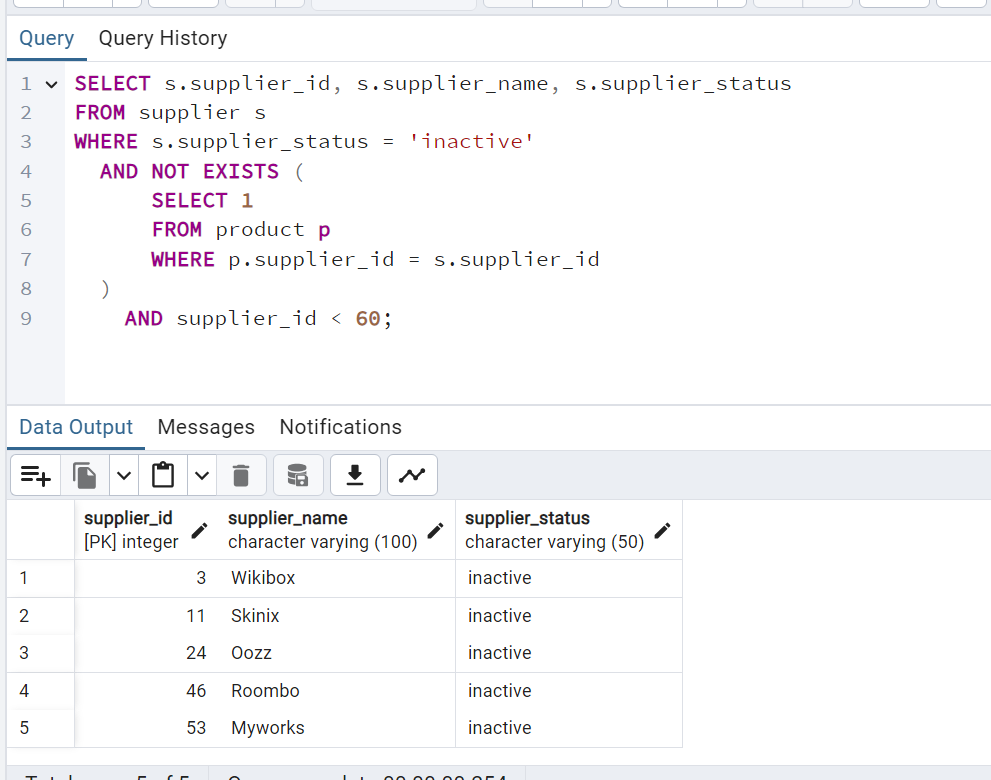

#### After Deletion

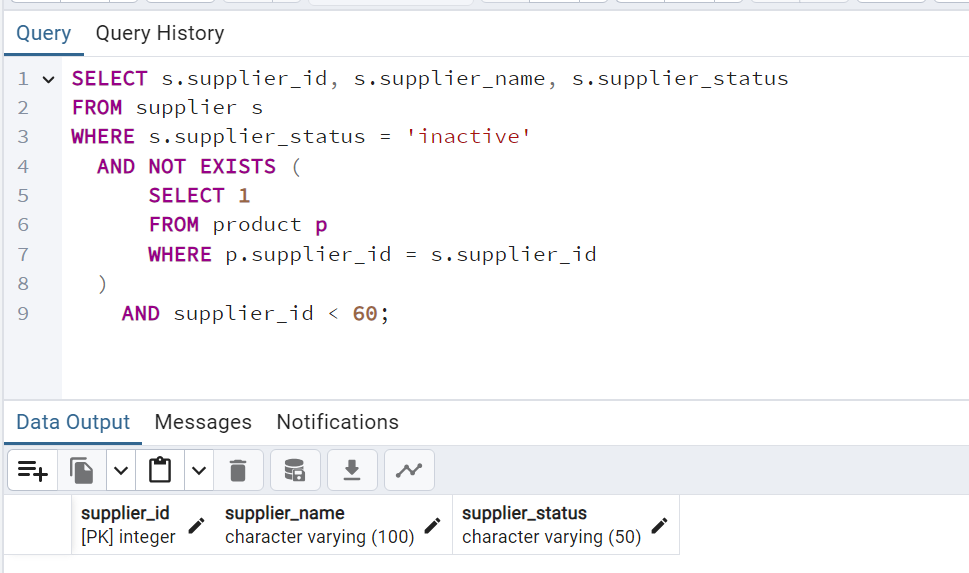

---

## 5. Constraints

### Constraint 1 – Product Base Price Must Be Positive

A `CHECK` constraint was added to `product` in order to ensure that `base_price` is greater than 0.

This prevents invalid product prices such as zero or negative values.

#### Validation Before Adding the Constraint

```sql
SELECT product_id, product_name, base_price
FROM product
WHERE base_price <= 0;
```

#### Constraint Statement

```sql
ALTER TABLE product
ADD CONSTRAINT chk_product_base_price_positive
CHECK (base_price > 0);
```

#### Attempted Violation

```sql
UPDATE product
SET base_price = -10
WHERE product_id = 1;
```

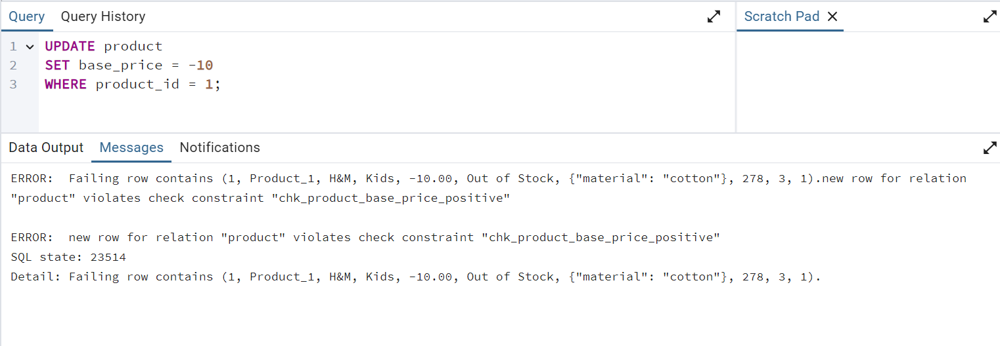

---

### Constraint 2 – Inventory Quantity Must Be Non-Negative

A `CHECK` constraint was added to `inventory` in order to ensure that `quantity_in_stock` is greater than or equal to 0.

This prevents impossible inventory states such as negative stock quantity.

#### Validation Before Adding the Constraint

```sql
SELECT inventory_id, product_id, quantity_in_stock
FROM inventory
WHERE quantity_in_stock < 0;
```

#### Constraint Statement

```sql
ALTER TABLE inventory
ADD CONSTRAINT chk_inventory_quantity_nonnegative
CHECK (quantity_in_stock >= 0);
```

#### Attempted Violation

```sql
UPDATE inventory
SET quantity_in_stock = -5
WHERE inventory_id = 1;
```

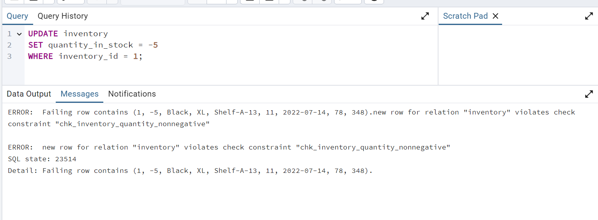

---

### Constraint 3 – Discount Percent Must Be Between 0 and 100

A `CHECK` constraint was added to `sale_inventory` in order to ensure that `discount_percent` is between 0 and 100.

Since `sale_inventory` is an associative table with a composite primary key (`sale_id`, `inventory_id`), the violation test was performed using an existing key pair.

#### Validation Before Adding the Constraint

```sql
SELECT sale_id, inventory_id, discount_percent
FROM sale_inventory
WHERE discount_percent < 0 OR discount_percent > 100;
```

#### Constraint Statement

```sql
ALTER TABLE sale_inventory
ADD CONSTRAINT chk_sale_inventory_discount_percent_range
CHECK (discount_percent >= 0 AND discount_percent <= 100);
```

#### Attempted Violation

```sql
UPDATE sale_inventory
SET discount_percent = 150
WHERE sale_id = [EXISTING_SALE_ID] AND inventory_id = [EXISTING_INVENTORY_ID];
```

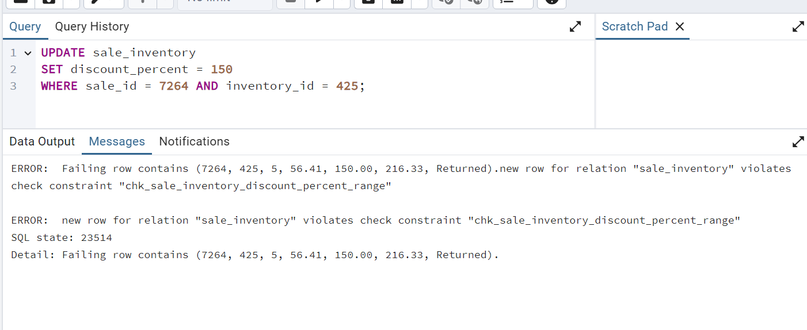

---

### Motivation for the Added Constraints

The added constraints improve the reliability and realism of the database by enforcing core business rules directly inside the database engine.

* `chk_product_base_price_positive` ensures that products cannot be assigned invalid prices.
* `chk_inventory_quantity_nonnegative` ensures that stock levels remain realistic and prevents impossible inventory values.
* `chk_sale_inventory_discount_percent_range` ensures that discount values remain within a valid percentage range.

These constraints reduce the risk of inconsistent or logically invalid data and help preserve data integrity even if incorrect values are attempted through direct SQL operations or future application interfaces.

---

## 6. Transaction Management – ROLLBACK and COMMIT

### Demonstration of ROLLBACK

A transaction was opened using `BEGIN`, an update was performed, and the result of the update was displayed.
Afterward, `ROLLBACK` was executed, and the same record was queried again in order to verify that the original value was restored.

#### Transaction Script

```sql
BEGIN;

UPDATE product
SET base_price = base_price * 0.5
WHERE product_id = 190;

SELECT product_id, base_price
FROM product
WHERE product_id = 190;

ROLLBACK;

SELECT product_id, base_price
FROM product
WHERE product_id = 190;
```

#### ROLLBACK Demonstration

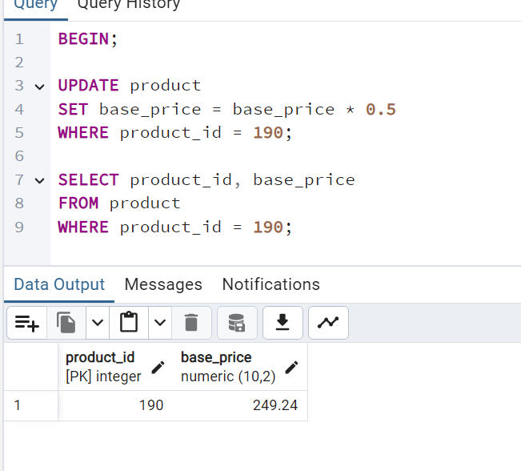

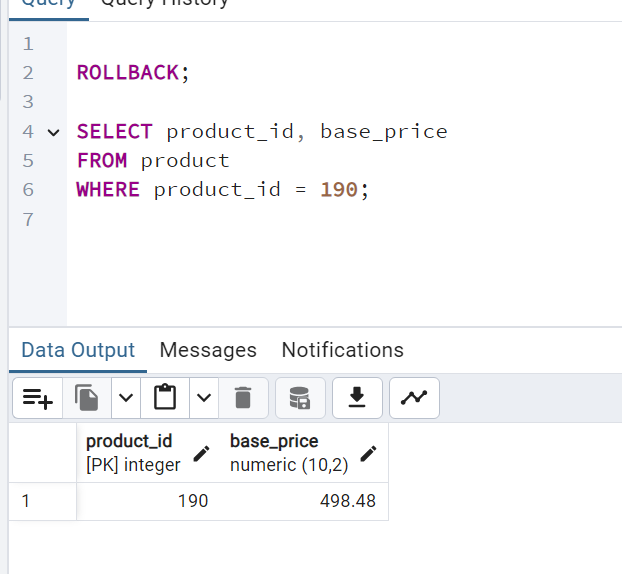

---

### Demonstration of COMMIT

* `BEGIN`
* `DELETE`
* `COMMIT`
* `SELECT`
```

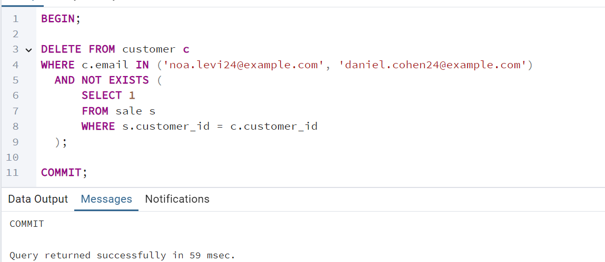

---

## 7. Indexes and Query Optimization

The following indexes and performance comparisons were implemented by the second team member.
Detailed explanations, SQL statements, screenshots, and conclusions will be added after receiving the final material.

### Index 1 – [TO BE COMPLETED]

**Purpose:**
*To be added.*

```sql
-- To be added
```

**Before Index:**
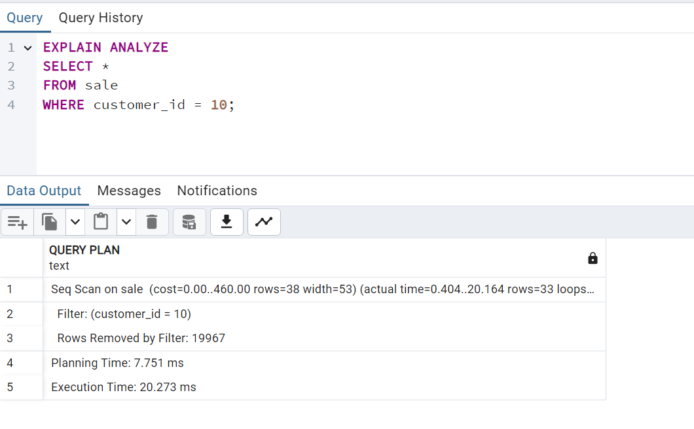

**After Index:**
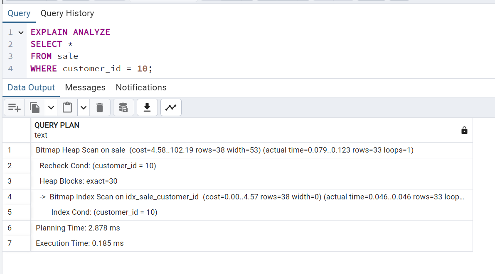

---

### Index 2 – [TO BE COMPLETED]

**Purpose:**
*To be added.*

```sql
-- To be added
```

**Before Index:**
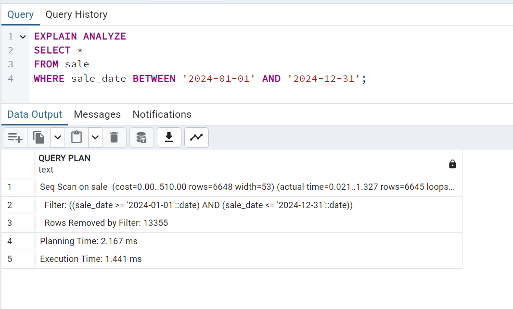

**After Index:**
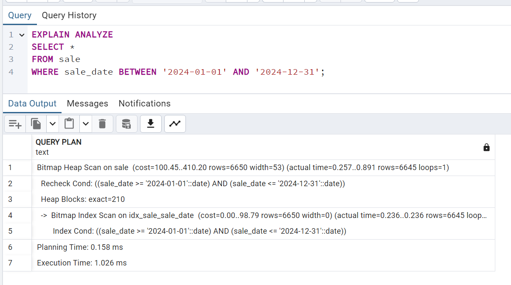

---

### Index 3 – [TO BE COMPLETED]

**Purpose:**
*To be added.*

```sql
-- To be added
```

**Before Index:**
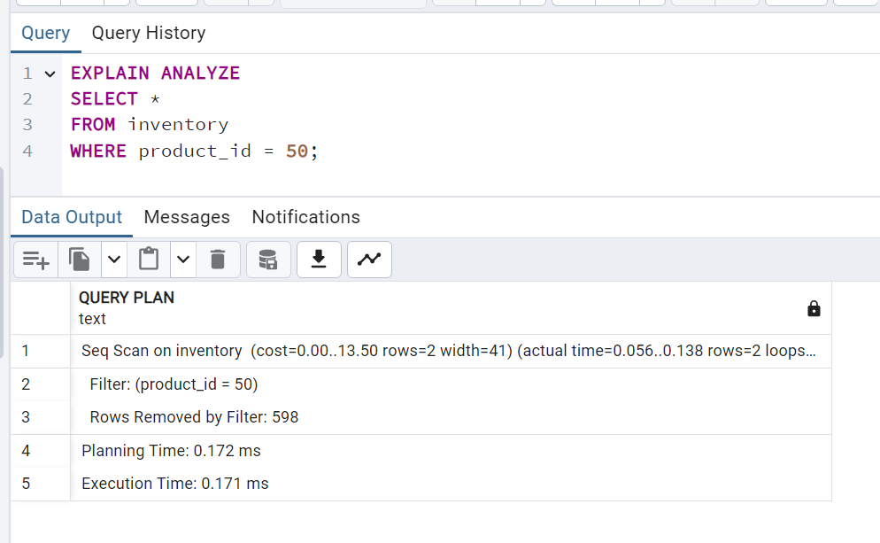

**After Index:**
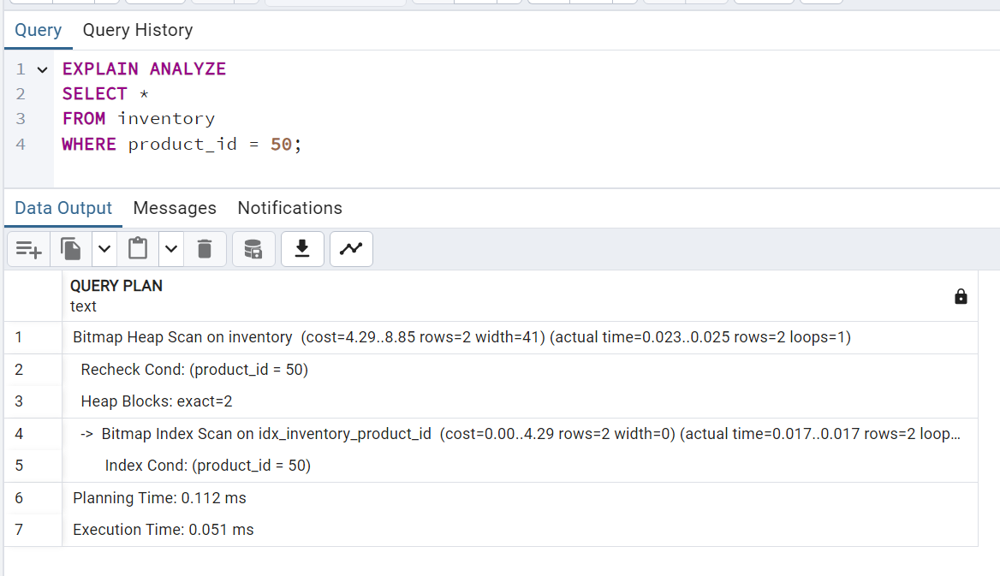

---

## 8. Stage 2 Files

The following files are included in the Stage 2 submission:

* `select_queries.sql`
* `update_queries`
* `Constraints.sql`
* `RollbackCommit.sql`
* `Index.sql`
* `backup2`

Supporting screenshot files are stored in the `stage2/images/` directory and are referenced throughout this document.
