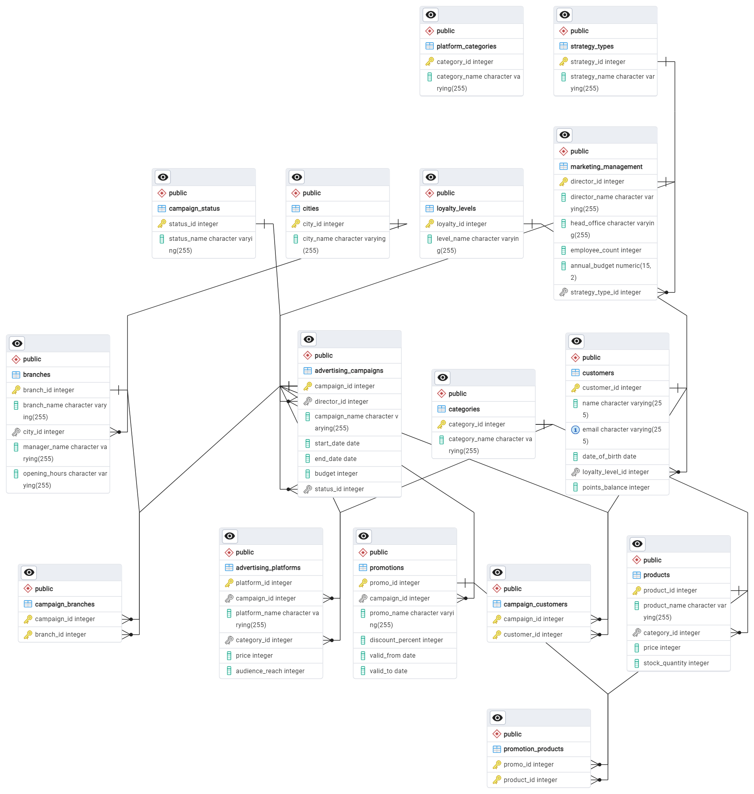
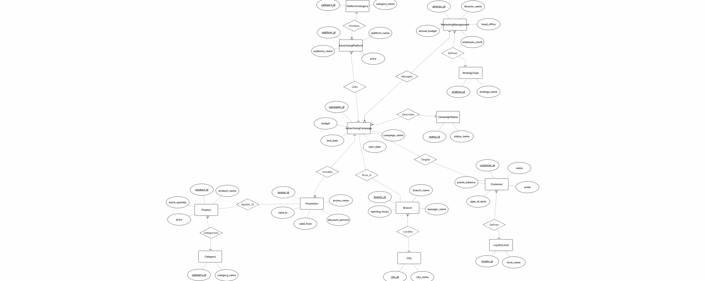
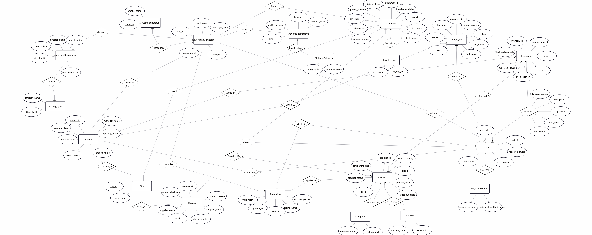
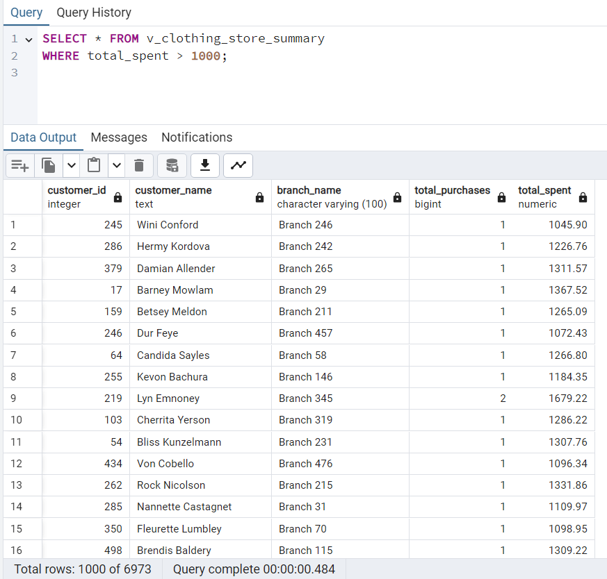
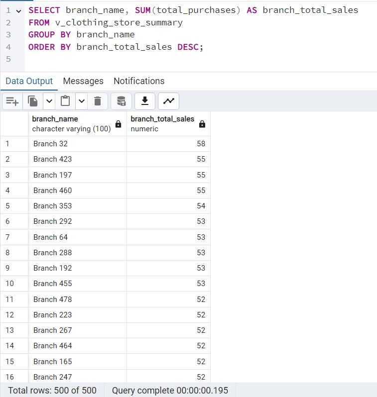
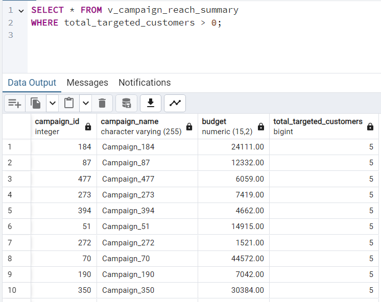
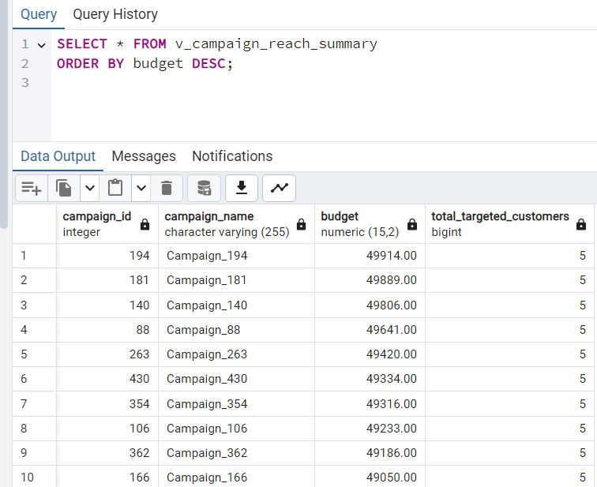
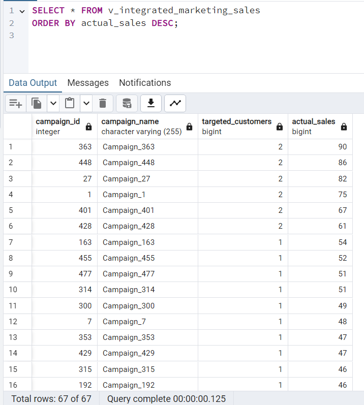
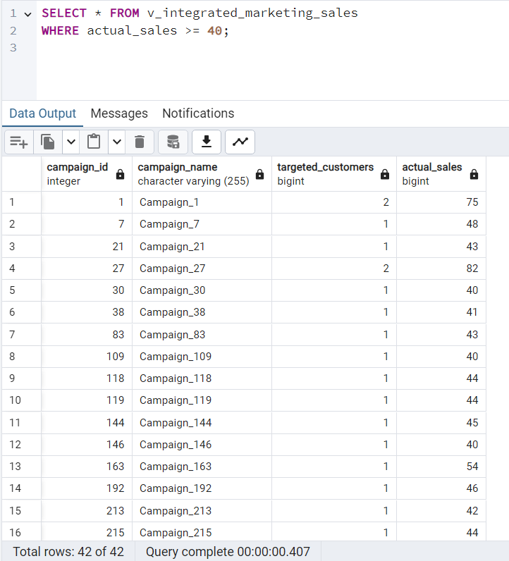

# Stage 3 – Integration and Views

This document presents **Stage 3** of the Database Systems course project.

In this stage, two independent database systems were analyzed, integrated, and merged into a single unified database system.

The process included:

* reverse engineering of an external database system
* creation of DSD and ERD diagrams
* schema analysis and mapping
* integration of both database structures
* importing and merging data from both systems
* creation of integrated relationships and associative tables
* creation of SQL Views for business analysis

The goal of this stage was to demonstrate understanding of database integration processes, schema analysis, reverse engineering techniques, and logical merging of two different systems into one coherent database structure.

---

# Table of Contents

1. [Stage 3 Overview](#1-stage-3--integration-and-views)
2. [Reverse Engineering of the External Database](#2-reverse-engineering-of-the-external-database)
3. [Original Systems Analysis](#3-original-systems-analysis)
4. [Integrated ERD Design](#4-integrated-erd-design)
5. [Schema Integration Process](#5-schema-integration-process)
6. [Data Integration and Import Process](#6-data-integration-and-import-process)
7. [Views](#7-views)
8. [Stage 3 Files](#8-stage-3-files)

---

# 1. Stage 3 – Integration and Views

In this stage, the original clothing retail management database created in previous stages was integrated with an additional external database system received as part of the project requirements.

The work included:

* analyzing the external database structure
* generating DSD diagrams using reverse engineering
* reconstructing the external ERD
* comparing both database systems
* designing a unified integrated schema
* creating additional tables and relationships
* importing and merging data from both systems
* creating business-oriented SQL Views

The final result is a unified database system that combines both original systems into a single coherent structure.

---

# 2. Reverse Engineering of the External Database

The external database system was received as a PostgreSQL backup file.

The backup was restored into a separate PostgreSQL database environment in order to analyze its structure independently from the original project database.

Using pgAdmin reverse engineering tools, a DSD (Database Schema Diagram) was generated automatically from the restored database.

The generated schema included the following main entities:

* marketing_management
* advertising_campaign
* advertising_platform
* customer
* branch
* product
* promotion
* campaign_customer
* campaign_branch
* promotion_product
* loyalty_level
* strategy_type
* campaign_status
* category
* city

The analysis of the external database allowed reconstruction of the logical ERD and understanding of the business logic behind the system.

### External Database DSD



### Reconstructed External ERD



---

# 3. Original Systems Analysis

Before integration, both systems were analyzed in order to identify:

* overlapping entities
* compatible attributes
* shared business concepts
* conflicting primary keys
* possible relationship mappings

Several entities appeared in both systems, including:

* customer
* branch
* product
* category
* city

However, each system stored different business information and used different structures.

The external system focused primarily on marketing campaigns and customer targeting, while the original project focused on sales, inventory management, suppliers, and retail operations.

---

# 4. Integrated ERD Design

After analyzing both systems, a unified ERD was designed.

The integration process included:

* preserving the original retail management system
* extending the database with marketing and campaign management features
* creating new associative tables
* adding new business relationships
* resolving schema conflicts

The final integrated schema combines retail operations with marketing campaign management and customer targeting functionality.

### Final Integrated ERD



---

# 5. Schema Integration Process

Several schema modifications were required in order to integrate both systems.

The process included:

* creating new tables
* adding foreign keys
* creating associative tables
* resolving naming conflicts
* preserving referential integrity

Examples of newly integrated tables:

* marketing_management
* advertising_campaign
* advertising_platform
* promotion
* campaign_customer
* campaign_branch
* promotion_product
* loyalty_level
* strategy_type
* campaign_status

In addition, several relationships were added between existing retail entities and the new marketing entities.

---

# 6. Data Integration and Import Process

The integration process included importing data from both systems into the unified database.

The following steps were performed:

1. restoring the external backup into a temporary database
2. exporting selected tables into CSV files
3. importing data into staging tables
4. mapping external attributes into the integrated schema
5. resolving primary key conflicts using ID shifting
6. inserting the integrated data into the final tables

Several entities required schema mapping due to structural differences between the systems.

For example:

* customer names from the external system were mapped into the original customer structure
* external product records were merged into the existing product table
* branch identifiers were shifted in order to prevent primary key conflicts

Additional integrated data was later generated for empty campaign-related tables in order to support realistic business analysis and SQL Views.

---

# 7. Views

## View 1 – Clothing Store Summary View

### Description

This view belongs to the original clothing store management system.

The view combines the `customer`, `sale`, and `branch` tables in order to generate a summary report about customer purchasing behavior across different branches.

The view presents:

* customer information
* branch name
* number of purchases performed by each customer
* total amount spent by each customer

### SQL Code

```sql
CREATE VIEW v_clothing_store_summary AS
SELECT
    c.customer_id,
    c.first_name || ' ' || c.last_name AS customer_name,
    b.branch_name,
    COUNT(s.sale_id) AS total_purchases,
    SUM(s.total_amount) AS total_spent
FROM customer c
JOIN sale s ON c.customer_id = s.customer_id
JOIN branch b ON s.branch_id = b.branch_id
GROUP BY c.customer_id, c.first_name, c.last_name, b.branch_name;
```

### Query Examples

```sql
-- Query A: VIP customers who spent more than 1000 total
SELECT *
FROM v_clothing_store_summary
WHERE total_spent > 1000;

-- Query B: Total purchases per branch ordered from highest to lowest
SELECT branch_name, SUM(total_purchases) AS branch_total_sales
FROM v_clothing_store_summary
GROUP BY branch_name
ORDER BY branch_total_sales DESC;
```

### View Screenshots

**Query A Results:**



**Query B Results:**



---

## View 2 – Campaign Reach Summary View

### Description

This view belongs to the external campaign management system.

The view combines the `advertising_campaign` table with the `campaign_customer` table in order to analyze campaign reach and customer targeting.

The view presents:

* campaign information
* campaign budget
* number of targeted customers for each campaign

### SQL Code

```sql
CREATE VIEW v_campaign_reach_summary AS
SELECT
    ac.campaign_id,
    ac.campaign_name,
    ac.budget,
    COUNT(cc.customer_id) AS total_targeted_customers
FROM advertising_campaign ac
LEFT JOIN campaign_customer cc
ON ac.campaign_id = cc.campaign_id
GROUP BY ac.campaign_id, ac.campaign_name, ac.budget;
```

### Query Examples

```sql
-- Query A: Campaigns with no targeted customers
SELECT *
FROM v_campaign_reach_summary
WHERE total_targeted_customers = 0;

-- Query B: Campaigns ordered by highest budget
SELECT *
FROM v_campaign_reach_summary
ORDER BY budget DESC;
```

### View Screenshots

**Query A Results:**



**Query B Results:**



---

## View 3 – Integrated Marketing and Sales View

### Description

This is the main integrated view of Stage 3.

The view combines entities from both systems:

* `advertising_campaign`
* `campaign_customer`
* `sale`

The goal of the view is to analyze the real business impact of marketing campaigns on actual store sales.

The view presents:

* campaign information
* number of targeted customers
* number of actual purchases performed by customers who participated in campaigns

This view demonstrates the successful integration between the original retail management system and the external marketing campaign system.

### SQL Code

```sql
CREATE VIEW v_integrated_marketing_sales AS
SELECT
    ac.campaign_id,
    ac.campaign_name,
    COUNT(DISTINCT cc.customer_id) AS targeted_customers,
    COUNT(DISTINCT s.sale_id) AS actual_sales
FROM advertising_campaign ac
JOIN campaign_customer cc
ON ac.campaign_id = cc.campaign_id
JOIN sale s
ON cc.customer_id = s.customer_id
GROUP BY ac.campaign_id, ac.campaign_name;
```

### Query Examples

```sql
-- Query A: Campaigns that generated the highest number of actual sales
SELECT *
FROM v_integrated_marketing_sales
ORDER BY actual_sales DESC;

-- Query B: Campaigns with 40 or more actual sales
SELECT *
FROM v_integrated_marketing_sales
WHERE actual_sales >= 40;
```

### View Screenshots

**Query A Results:**



**Query B Results:**



---

# 8. Stage 3 Files

The following files are included in the Stage 3 submission:

* `Integration.sql`
* `Views.sql`
* `backup3`

Supporting screenshots and diagrams are stored in the `stage3/images/` directory and are referenced throughout this document.
