# Stage 4 – PL/pgSQL Programming

This document presents **Stage 4** of the Database Systems course project.

In this stage, PL/pgSQL programming was added to the integrated database system created in Stage 3.

The work included:

* writing stored functions
* writing stored procedures
* writing triggers
* writing main SQL programs that call functions and procedures
* testing business logic on the integrated database
* demonstrating successful execution using screenshots

The goal of this stage was to demonstrate the ability to implement business logic inside the database, beyond regular SQL queries.

---

# Table of Contents

1. [Stage 4 Overview](#1-stage-4--plpgsql-programming)
2. [Integrated Database Context](#2-integrated-database-context)
3. [Functions](#3-functions)
4. [Procedures](#4-procedures)
5. [Triggers](#5-triggers)
6. [Main Programs](#6-main-programs)
7. [Alter Table File](#7-alter-table-file)
8. [Stage 4 Files](#8-stage-4-files)

---

# 1. Stage 4 – PL/pgSQL Programming

In this stage, the integrated database system was extended with PL/pgSQL code.

The database already combines the original clothing retail management system with the external marketing campaign management system from Stage 3.

The PL/pgSQL programs were designed to support meaningful business operations such as:

* customer marketing analysis
* employee bonus calculation
* applying campaign discounts
* restocking low inventory
* validating sale items
* updating inventory automatically after sales

The implementation includes:

* 2 functions
* 2 procedures
* 2 triggers
* 2 main programs

---

# 2. Integrated Database Context

The functions, procedures and triggers are based on the integrated database from Stage 3.

The integrated system includes both retail entities and marketing entities, such as:

* `customer`
* `employee`
* `sale`
* `sale_inventory`
* `inventory`
* `branch`
* `advertising_campaign`
* `campaign_customer`
* `promotion`
* `loyalty_level`

This allows the PL/pgSQL code to combine operational retail data with marketing campaign data.

---

# 3. Functions

## Function 1 – Customer Marketing Score

### File

`01_function_calculate_customer_marketing_score.sql`

### Description

This function calculates a marketing score for a customer.

The function combines data from the original retail system and the integrated marketing system.
It receives a customer id and returns a numeric score that represents the customer's marketing value.

The score is based on:

* total amount spent by the customer
* number of campaigns that targeted the customer
* number of campaign-related sales
* customer loyalty level

### PL/pgSQL Elements Used

* explicit cursor
* loop
* record variable
* conditional statements
* exception handling
* calculations
* joins across several tables

### SQL Code

```sql
-- 01_function_calculate_customer_marketing_score.sql
-- Function 1: Calculates a marketing value score for a customer.
-- Business logic:
--   * Gives points for total purchases.
--   * Gives points for number of targeted campaigns.
--   * Gives points for actual campaign-related purchases.
--   * Adds a loyalty-level bonus.
--   * Uses an explicit cursor, loop, conditions, records and exception handling.

CREATE OR REPLACE FUNCTION public.calculate_customer_marketing_score(p_customer_id INTEGER)
RETURNS NUMERIC
LANGUAGE plpgsql
AS $$
DECLARE
    v_customer_exists INTEGER;
    v_loyalty_name VARCHAR(255);
    v_total_spent NUMERIC := 0;
    v_targeted_campaigns INTEGER := 0;
    v_campaign_sales INTEGER := 0;
    v_score NUMERIC := 0;
    v_sale_record RECORD;

    cur_customer_sales CURSOR FOR
        SELECT s.sale_id, s.total_amount, s.campaign_id
        FROM public.sale s
        WHERE s.customer_id = p_customer_id;
BEGIN
    SELECT COUNT(*)
    INTO v_customer_exists
    FROM public.customer c
    WHERE c.customer_id = p_customer_id;

    IF v_customer_exists = 0 THEN
        RAISE EXCEPTION 'Customer with id % does not exist', p_customer_id;
    END IF;

    SELECT ll.level_name
    INTO v_loyalty_name
    FROM public.customer c
    LEFT JOIN public.loyalty_level ll ON c.loyalty_id = ll.loyalty_id
    WHERE c.customer_id = p_customer_id;

    SELECT COUNT(*)
    INTO v_targeted_campaigns
    FROM public.campaign_customer cc
    WHERE cc.customer_id = p_customer_id;

    OPEN cur_customer_sales;

    LOOP
        FETCH cur_customer_sales INTO v_sale_record;
        EXIT WHEN NOT FOUND;

        v_total_spent := v_total_spent + COALESCE(v_sale_record.total_amount, 0);

        IF v_sale_record.campaign_id IS NOT NULL THEN
            v_campaign_sales := v_campaign_sales + 1;
        END IF;
    END LOOP;

    CLOSE cur_customer_sales;

    v_score := (v_total_spent / 100)
               + (v_targeted_campaigns * 10)
               + (v_campaign_sales * 20);

    IF LOWER(COALESCE(v_loyalty_name, '')) IN ('vip', 'gold', 'premium') THEN
        v_score := v_score + 50;
    ELSIF LOWER(COALESCE(v_loyalty_name, '')) IN ('silver') THEN
        v_score := v_score + 25;
    END IF;

    RETURN ROUND(v_score, 2);

EXCEPTION
    WHEN OTHERS THEN
        IF cur_customer_sales%ISOPEN THEN
            CLOSE cur_customer_sales;
        END IF;
        RAISE;
END;
$$;
```

### Execution Screenshot

**Function creation:**

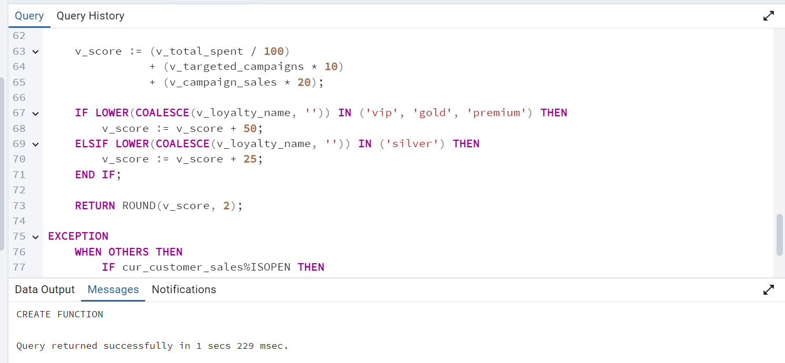

**Function execution:**

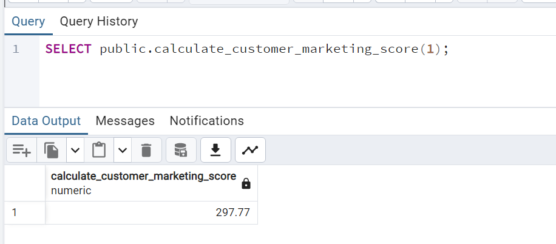

---

## Function 2 – Employee Bonus Calculation

### File

`02_function_calculate_employee_bonus.sql`

### Description

This function calculates an employee bonus according to sales performance.

The function receives an employee id and returns the bonus amount the employee should receive.
The bonus is calculated according to the total sales amount and the number of sales performed by the employee.

### Business Logic

* Completed sales are counted.
* Cancelled sales are ignored.
* The total sales amount determines the bonus percentage.
* A high number of sales gives an additional fixed bonus.

### PL/pgSQL Elements Used

* implicit cursor using `FOR ... IN SELECT`
* loop
* record variable
* conditional statements
* exception handling
* calculations

### SQL Code

```sql
-- 02_function_calculate_employee_bonus.sql
-- Function 2: Calculates an employee bonus according to sales performance.
-- Business logic:
--   * Sums all completed/non-cancelled sales made by the employee.
--   * Counts number of sales.
--   * Gives bonus by sales tiers.
--   * Adds an extra bonus for a high number of sales.
--   * Uses implicit cursor, conditions, calculations and exception handling.

CREATE OR REPLACE FUNCTION public.calculate_employee_bonus(p_employee_id INTEGER)
RETURNS NUMERIC
LANGUAGE plpgsql
AS $$
DECLARE
    v_employee_exists INTEGER;
    v_total_sales NUMERIC := 0;
    v_sale_count INTEGER := 0;
    v_bonus NUMERIC := 0;
    sale_rec RECORD;
BEGIN
    SELECT COUNT(*)
    INTO v_employee_exists
    FROM public.employee e
    WHERE e.employee_id = p_employee_id;

    IF v_employee_exists = 0 THEN
        RAISE EXCEPTION 'Employee with id % does not exist', p_employee_id;
    END IF;

    FOR sale_rec IN
        SELECT s.sale_id, COALESCE(s.total_amount, 0) AS total_amount
        FROM public.sale s
        WHERE s.employee_id = p_employee_id
          AND COALESCE(LOWER(s.sale_status), 'completed') NOT IN ('cancelled', 'canceled')
    LOOP
        v_total_sales := v_total_sales + sale_rec.total_amount;
        v_sale_count := v_sale_count + 1;
    END LOOP;

    IF v_total_sales >= 50000 THEN
        v_bonus := v_total_sales * 0.08;
    ELSIF v_total_sales >= 25000 THEN
        v_bonus := v_total_sales * 0.05;
    ELSIF v_total_sales >= 10000 THEN
        v_bonus := v_total_sales * 0.03;
    ELSE
        v_bonus := v_total_sales * 0.01;
    END IF;

    IF v_sale_count >= 100 THEN
        v_bonus := v_bonus + 500;
    ELSIF v_sale_count >= 50 THEN
        v_bonus := v_bonus + 250;
    END IF;

    RETURN ROUND(v_bonus, 2);

EXCEPTION
    WHEN OTHERS THEN
        RAISE;
END;
$$;
```

### Execution Screenshot

**Function creation:**

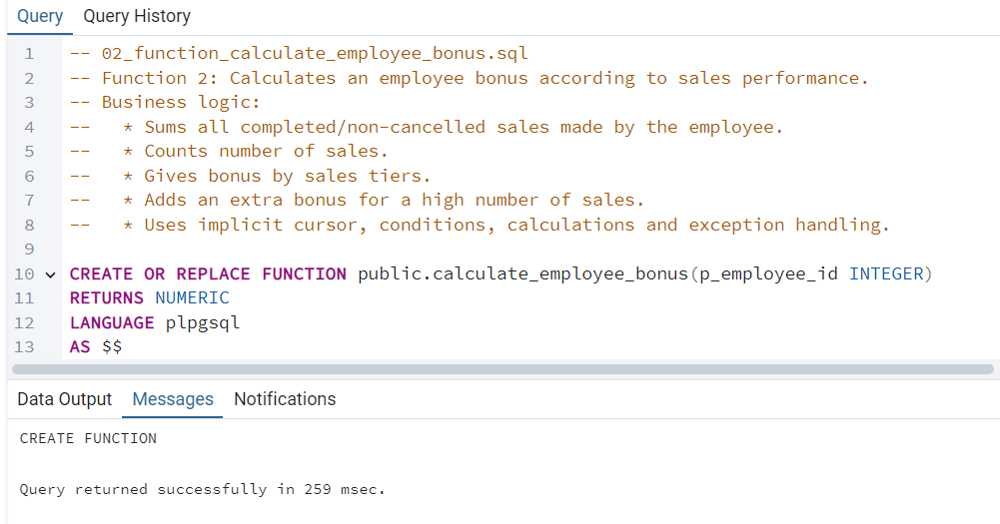

**Function execution:**

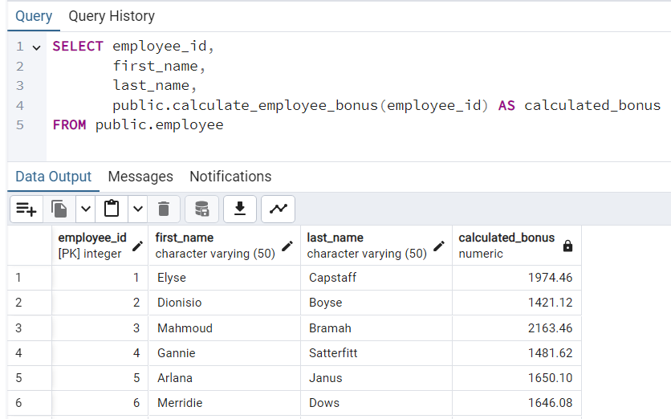

---

# 4. Procedures

## Procedure 1 – Apply Campaign Discount

### File

`03_procedure_apply_campaign_discount.sql`

### Description

This procedure applies an active promotion discount to sales that belong to a specific advertising campaign.

The procedure receives a campaign id, finds the active promotion related to that campaign, updates the discount on sale items, recalculates final prices, and updates the total sale amount.

### Business Logic

* The campaign must exist.
* The campaign must have an active promotion.
* The highest active discount is selected if there is more than one promotion.
* Sale items related to the campaign are updated.
* The total amount in the `sale` table is recalculated.

### PL/pgSQL Elements Used

* loop
* record variable
* conditional statements
* DML commands using `UPDATE`
* exception handling
* aggregate calculation

### SQL Code

```sql
-- 03_procedure_apply_campaign_discount.sql
-- Procedure 1: Applies campaign promotion discounts to sales that belong to a campaign.
-- Business logic:
--   * Finds the active promotion of a campaign.
--   * Updates sale_inventory rows of sales that belong to the campaign.
--   * Recalculates final_price for each sale item.
--   * Recalculates the total_amount in the sale table.
--   * Uses records, loops, DML, conditions and exception handling.

CREATE OR REPLACE PROCEDURE public.apply_campaign_discount(p_campaign_id INTEGER)
LANGUAGE plpgsql
AS $$
DECLARE
    v_campaign_exists INTEGER;
    v_promo_id INTEGER;
    v_discount NUMERIC(5,2);
    v_updated_items INTEGER := 0;
    sale_rec RECORD;
BEGIN
    SELECT COUNT(*)
    INTO v_campaign_exists
    FROM public.advertising_campaign ac
    WHERE ac.campaign_id = p_campaign_id;

    IF v_campaign_exists = 0 THEN
        RAISE EXCEPTION 'Campaign with id % does not exist', p_campaign_id;
    END IF;

    SELECT p.promo_id, COALESCE(p.discount_percent, 0)::NUMERIC(5,2)
    INTO v_promo_id, v_discount
    FROM public.promotion p
    WHERE p.campaign_id = p_campaign_id
      AND (p.valid_from IS NULL OR p.valid_from <= CURRENT_DATE)
      AND (p.valid_to IS NULL OR p.valid_to >= CURRENT_DATE)
    ORDER BY COALESCE(p.discount_percent, 0) DESC, p.promo_id
    LIMIT 1;

    IF v_promo_id IS NULL THEN
        RAISE EXCEPTION 'No active promotion was found for campaign id %', p_campaign_id;
    END IF;

    FOR sale_rec IN
        SELECT s.sale_id
        FROM public.sale s
        WHERE s.campaign_id = p_campaign_id
          AND COALESCE(LOWER(s.sale_status), 'completed') NOT IN ('cancelled', 'canceled')
    LOOP
        UPDATE public.sale_inventory si
        SET discount_percent = v_discount,
            final_price = ROUND((COALESCE(si.unit_price, 0) * si.quantity * (1 - v_discount / 100.0))::NUMERIC, 2)
        WHERE si.sale_id = sale_rec.sale_id;

        GET DIAGNOSTICS v_updated_items = ROW_COUNT;

        UPDATE public.sale s
        SET promo_id = v_promo_id,
            total_amount = COALESCE((
                SELECT SUM(COALESCE(si.final_price, 0))
                FROM public.sale_inventory si
                WHERE si.sale_id = sale_rec.sale_id
            ), 0)
        WHERE s.sale_id = sale_rec.sale_id;
    END LOOP;

    RAISE NOTICE 'Campaign discount applied. Campaign id: %, Promotion id: %, Discount: %%%',
        p_campaign_id, v_promo_id, v_discount;

EXCEPTION
    WHEN OTHERS THEN
        RAISE;
END;
$$;
```

### Execution Screenshot

**Procedure creation:**

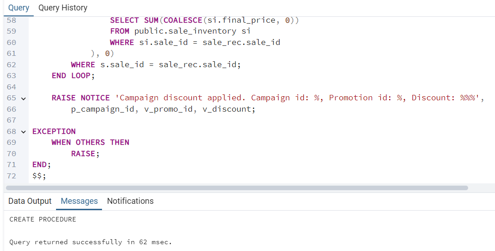

**Before procedure execution:**

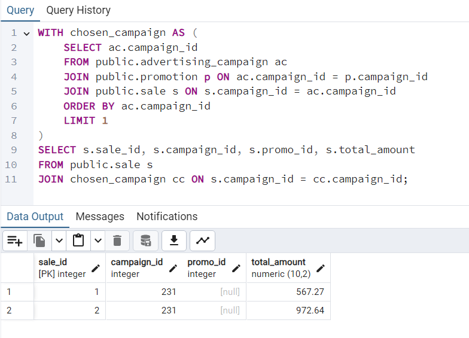

**After procedure execution:**

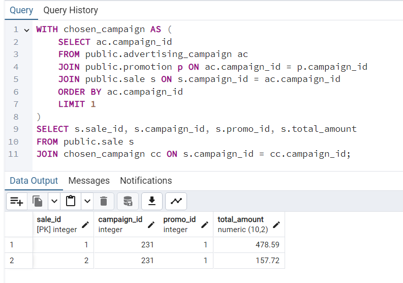

---

## Procedure 2 – Restock Low Inventory

### File

`04_procedure_restock_low_inventory.sql`

### Description

This procedure restocks inventory rows where the current quantity is below the minimum stock level.

The procedure can work on all branches or on a specific branch.
It updates the quantity in stock and the last restock date.

### Business Logic

* Inventory rows below their minimum stock level are found.
* Each matching row is restocked to `min_stock_level + p_extra_units`.
* The last restock date is updated to the current date.
* If a branch id is provided, the procedure works only on that branch.

### PL/pgSQL Elements Used

* explicit cursor
* loop
* record variable
* conditional statements
* DML commands using `UPDATE`
* exception handling

### SQL Code

```sql
-- 04_procedure_restock_low_inventory.sql
-- Procedure 2: Restocks products whose stock is below the minimum level.
-- Business logic:
--   * Finds inventory rows where quantity_in_stock is below min_stock_level.
--   * Restocks them to min_stock_level + p_extra_units.
--   * Updates last_restock_date.
--   * Can run for all branches or for a specific branch.
--   * Uses explicit cursor, loops, records, DML, conditions and exception handling.

CREATE OR REPLACE PROCEDURE public.restock_low_inventory(
    p_branch_id INTEGER DEFAULT NULL,
    p_extra_units INTEGER DEFAULT 20
)
LANGUAGE plpgsql
AS $$
DECLARE
    v_branch_exists INTEGER;
    v_updated_count INTEGER := 0;
    inv_rec RECORD;

    cur_low_inventory CURSOR FOR
        SELECT i.inventory_id,
               i.branch_id,
               i.product_id,
               COALESCE(i.quantity_in_stock, 0) AS quantity_in_stock,
               COALESCE(i.min_stock_level, 0) AS min_stock_level
        FROM public.inventory i
        WHERE COALESCE(i.quantity_in_stock, 0) < COALESCE(i.min_stock_level, 0)
          AND (p_branch_id IS NULL OR i.branch_id = p_branch_id);
BEGIN
    IF p_extra_units < 0 THEN
        RAISE EXCEPTION 'Extra restock units cannot be negative. Received: %', p_extra_units;
    END IF;

    IF p_branch_id IS NOT NULL THEN
        SELECT COUNT(*)
        INTO v_branch_exists
        FROM public.branch b
        WHERE b.branch_id = p_branch_id;

        IF v_branch_exists = 0 THEN
            RAISE EXCEPTION 'Branch with id % does not exist', p_branch_id;
        END IF;
    END IF;

    OPEN cur_low_inventory;

    LOOP
        FETCH cur_low_inventory INTO inv_rec;
        EXIT WHEN NOT FOUND;

        UPDATE public.inventory i
        SET quantity_in_stock = inv_rec.min_stock_level + p_extra_units,
            last_restock_date = CURRENT_DATE
        WHERE i.inventory_id = inv_rec.inventory_id;

        v_updated_count := v_updated_count + 1;
    END LOOP;

    CLOSE cur_low_inventory;

    RAISE NOTICE 'Restock completed. Updated inventory rows: %', v_updated_count;

EXCEPTION
    WHEN OTHERS THEN
        IF cur_low_inventory%ISOPEN THEN
            CLOSE cur_low_inventory;
        END IF;
        RAISE;
END;
$$;
```

### Execution Screenshot

**Procedure creation:**

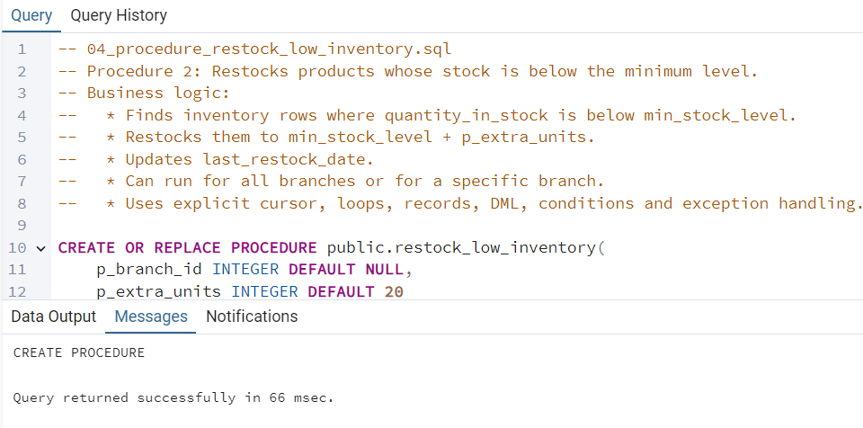

**Before procedure execution:**

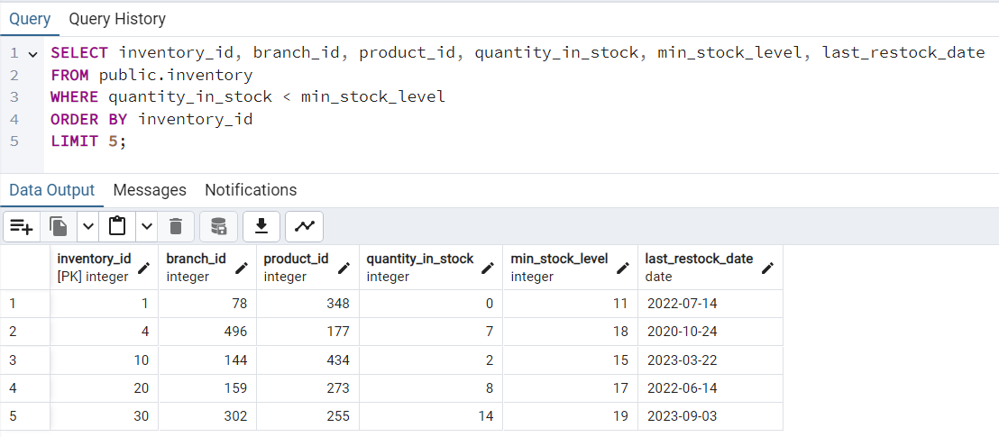

**After procedure execution:**

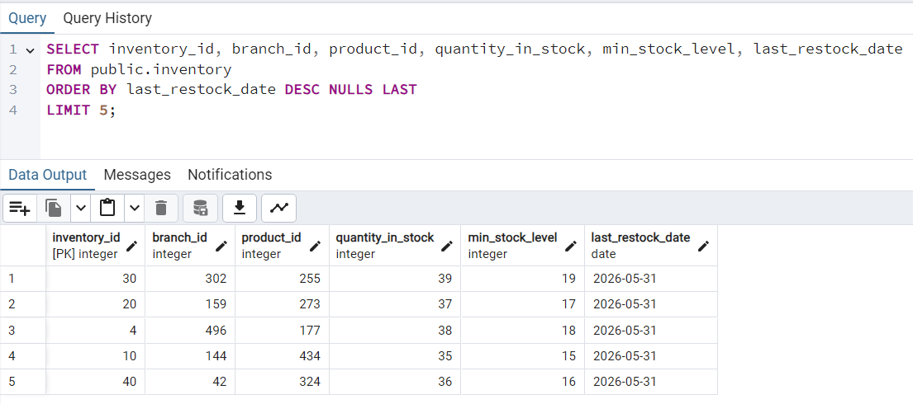

---

# 5. Triggers

## Trigger 1 – Validate Sale Item Before Insert or Update

### File

`05_trigger_validate_sale_item.sql`

### Description

This trigger validates sale item data before inserting or updating rows in the `sale_inventory` table.

The trigger enforces business rules and calculates the final price automatically.

### Business Logic

* Quantity must be positive.
* Unit price cannot be negative.
* Discount must be between 0 and 70.
* Discount above 20% is allowed only for VIP, Gold or Premium customers.
* Final price is calculated automatically according to quantity, unit price and discount.

This trigger runs on both `INSERT` and `UPDATE`, which satisfies the requirement that at least one trigger must run during an update operation.

### PL/pgSQL Elements Used

* trigger function
* `NEW` record
* conditional statements
* exception handling
* automatic derived data calculation
* validation logic

### SQL Code

```sql
-- 05_trigger_validate_sale_item.sql
-- Trigger 1: Business validation before INSERT or UPDATE on sale_inventory.
-- Business logic:
--   * Prevents negative or zero quantities.
--   * Prevents discounts outside 0-70.
--   * Prevents discounts over 20% for non-VIP/non-Gold/non-Premium customers.
--   * Calculates final_price automatically.
-- Requirement note: this trigger runs on UPDATE as required by Stage 4.

CREATE OR REPLACE FUNCTION public.trg_validate_sale_item()
RETURNS TRIGGER
LANGUAGE plpgsql
AS $$
DECLARE
    v_customer_id INTEGER;
    v_loyalty_name VARCHAR(255);
BEGIN
    IF NEW.quantity IS NULL OR NEW.quantity <= 0 THEN
        RAISE EXCEPTION 'Sale item quantity must be positive. Received: %', NEW.quantity;
    END IF;

    IF NEW.unit_price IS NULL OR NEW.unit_price < 0 THEN
        RAISE EXCEPTION 'Sale item unit price must be non-negative. Received: %', NEW.unit_price;
    END IF;

    NEW.discount_percent := COALESCE(NEW.discount_percent, 0);

    IF NEW.discount_percent < 0 OR NEW.discount_percent > 70 THEN
        RAISE EXCEPTION 'Discount percent must be between 0 and 70. Received: %', NEW.discount_percent;
    END IF;

    SELECT s.customer_id
    INTO v_customer_id
    FROM public.sale s
    WHERE s.sale_id = NEW.sale_id;

    IF v_customer_id IS NULL THEN
        RAISE EXCEPTION 'Sale % does not exist or has no customer', NEW.sale_id;
    END IF;

    SELECT ll.level_name
    INTO v_loyalty_name
    FROM public.customer c
    LEFT JOIN public.loyalty_level ll ON c.loyalty_id = ll.loyalty_id
    WHERE c.customer_id = v_customer_id;

    IF NEW.discount_percent > 20
       AND LOWER(COALESCE(v_loyalty_name, '')) NOT IN ('vip', 'gold', 'premium') THEN
        RAISE EXCEPTION 'Discount above 20%% is allowed only for VIP/Gold/Premium customers. Customer id: %, loyalty level: %',
            v_customer_id, COALESCE(v_loyalty_name, 'none');
    END IF;

    NEW.final_price := ROUND((NEW.unit_price * NEW.quantity * (1 - NEW.discount_percent / 100.0))::NUMERIC, 2);

    RETURN NEW;
END;
$$;

DROP TRIGGER IF EXISTS trg_validate_sale_item_before_change ON public.sale_inventory;

CREATE TRIGGER trg_validate_sale_item_before_change
BEFORE INSERT OR UPDATE ON public.sale_inventory
FOR EACH ROW
EXECUTE FUNCTION public.trg_validate_sale_item();
```

### Execution Screenshot

**Trigger creation:**

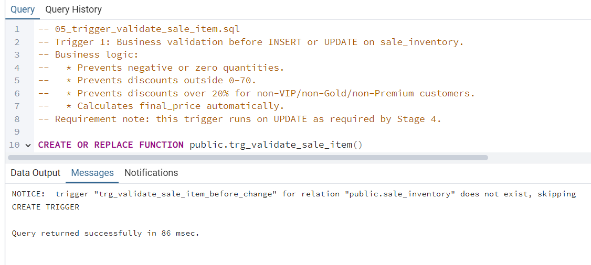

**Valid trigger execution:**

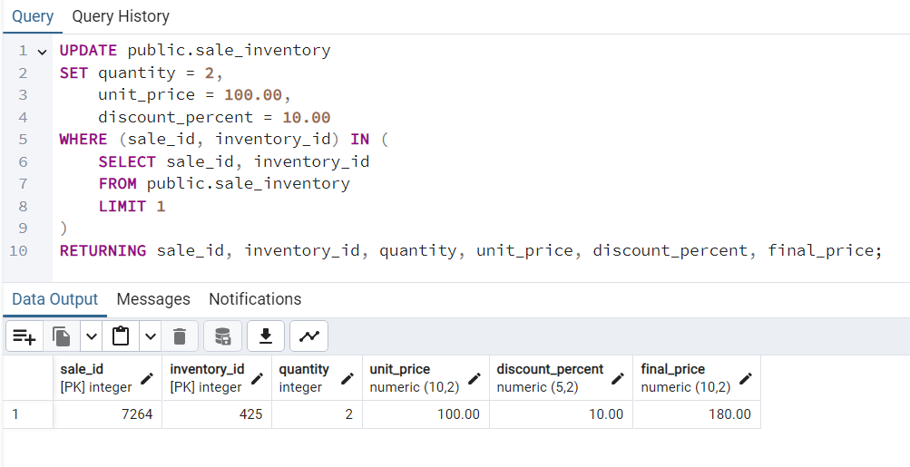

**Trigger exception example:**

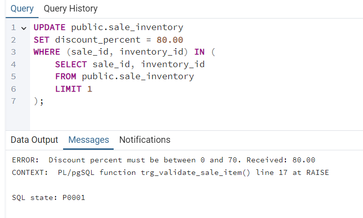

---

## Trigger 2 – Update Inventory After Sale Item Change

### File

`06_trigger_update_inventory_after_sale_item.sql`

### Description

This trigger updates product inventory automatically after inserting or updating a sale item.

It keeps the inventory quantity synchronized with sale activity.

### Business Logic

* After inserting a sale item, the sold quantity is subtracted from inventory.
* After updating a sale item, the inventory is adjusted according to the quantity difference.
* The trigger prevents the stock from becoming negative.
* The relevant inventory row is locked using `FOR UPDATE` during the check.

### PL/pgSQL Elements Used

* trigger function
* `NEW` and `OLD` records
* `TG_OP`
* conditional statements
* DML commands using `UPDATE`
* exception handling
* row locking using `FOR UPDATE`

### SQL Code

```sql
-- 06_trigger_update_inventory_after_sale_item.sql
-- Trigger 2: Updates derived inventory quantity after sale item changes.
-- Business logic:
--   * After INSERT into sale_inventory, subtracts sold quantity from inventory.
--   * After UPDATE, adjusts inventory according to the quantity difference.
--   * Prevents stock from becoming negative.
--   * Updates inventory automatically based on sale activity.

CREATE OR REPLACE FUNCTION public.trg_update_inventory_after_sale_item()
RETURNS TRIGGER
LANGUAGE plpgsql
AS $$
DECLARE
    v_current_stock INTEGER;
    v_quantity_delta INTEGER;
BEGIN
    IF TG_OP = 'INSERT' THEN
        v_quantity_delta := NEW.quantity;
    ELSIF TG_OP = 'UPDATE' THEN
        v_quantity_delta := NEW.quantity - OLD.quantity;
    ELSE
        RETURN NEW;
    END IF;

    SELECT COALESCE(i.quantity_in_stock, 0)
    INTO v_current_stock
    FROM public.inventory i
    WHERE i.inventory_id = NEW.inventory_id
    FOR UPDATE;

    IF v_current_stock IS NULL THEN
        RAISE EXCEPTION 'Inventory item % does not exist', NEW.inventory_id;
    END IF;

    IF v_current_stock - v_quantity_delta < 0 THEN
        RAISE EXCEPTION 'Not enough stock for inventory id %. Current stock: %, requested additional quantity: %',
            NEW.inventory_id, v_current_stock, v_quantity_delta;
    END IF;

    UPDATE public.inventory i
    SET quantity_in_stock = v_current_stock - v_quantity_delta
    WHERE i.inventory_id = NEW.inventory_id;

    RETURN NEW;
END;
$$;

DROP TRIGGER IF EXISTS trg_update_inventory_after_sale_item_change ON public.sale_inventory;

CREATE TRIGGER trg_update_inventory_after_sale_item_change
AFTER INSERT OR UPDATE ON public.sale_inventory
FOR EACH ROW
EXECUTE FUNCTION public.trg_update_inventory_after_sale_item();
```

### Execution Screenshot

**Trigger creation:**

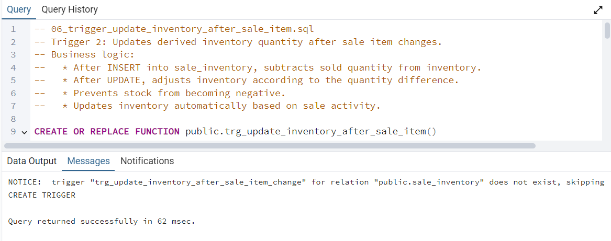

**Before trigger execution:**

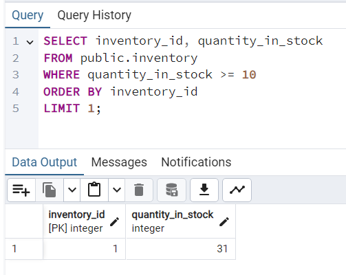

**After trigger execution:**

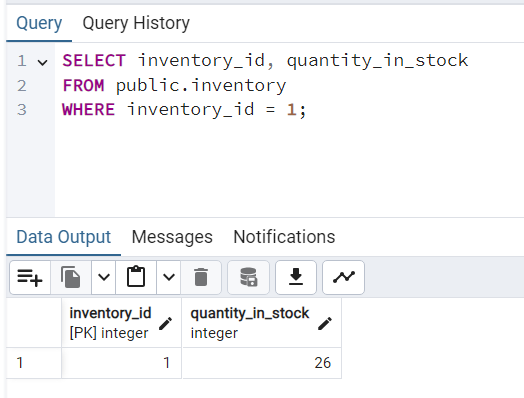

**Trigger exception example:**

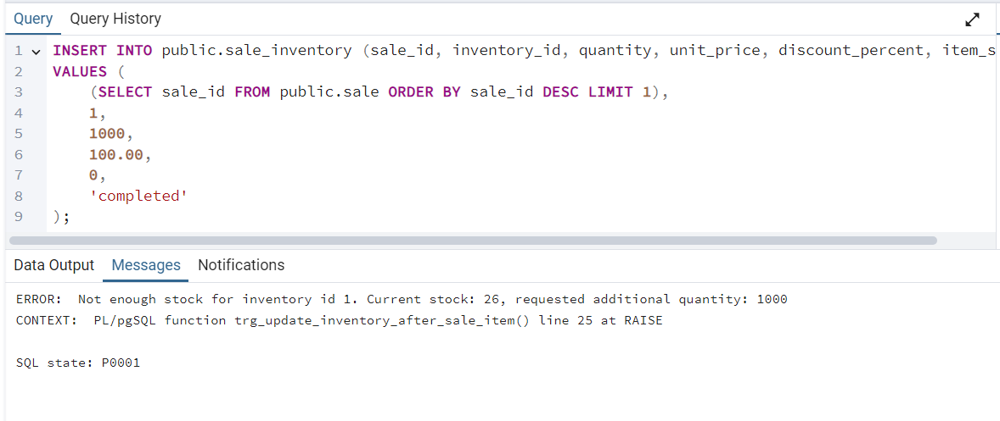

---

# 6. Main Programs

## Main Program 1 – Customer Campaign Program

### File

`07_main_program_customer_campaign.sql`

### Description

This main program demonstrates one function and one procedure.

It calls:

* `calculate_customer_marketing_score`
* `apply_campaign_discount`

The program first calculates a customer's marketing score, then chooses an existing campaign with a promotion and applies the campaign discount to related sales.

The program is wrapped in a transaction and ends with `ROLLBACK` for safe testing.

### SQL Code

```sql
-- 07_main_program_customer_campaign.sql
-- Main Program 1:
--   * Calls one function: calculate_customer_marketing_score
--   * Calls one procedure: apply_campaign_discount
-- Notes:
--   * The program dynamically chooses existing ids from the database.
--   * It is wrapped in a transaction so you can test safely.
--   * For screenshots, run section by section in pgAdmin.

BEGIN;

-- Before: choose an existing customer and show the marketing score.
WITH chosen_customer AS (
    SELECT customer_id
    FROM public.customer
    ORDER BY customer_id
    LIMIT 1
)
SELECT c.customer_id,
       c.first_name,
       c.last_name,
       public.calculate_customer_marketing_score(c.customer_id) AS marketing_score
FROM public.customer c
JOIN chosen_customer cc ON c.customer_id = cc.customer_id;

-- Before: choose an existing campaign with a promotion and show related sales.
WITH chosen_campaign AS (
    SELECT ac.campaign_id
    FROM public.advertising_campaign ac
    JOIN public.promotion p ON ac.campaign_id = p.campaign_id
    JOIN public.sale s ON s.campaign_id = ac.campaign_id
    ORDER BY ac.campaign_id
    LIMIT 1
)
SELECT s.sale_id, s.campaign_id, s.promo_id, s.total_amount
FROM public.sale s
JOIN chosen_campaign cc ON s.campaign_id = cc.campaign_id
ORDER BY s.sale_id
LIMIT 10;

-- Run procedure: apply campaign discount.
DO $$
DECLARE
    v_campaign_id INTEGER;
BEGIN
    SELECT ac.campaign_id
    INTO v_campaign_id
    FROM public.advertising_campaign ac
    JOIN public.promotion p ON ac.campaign_id = p.campaign_id
    JOIN public.sale s ON s.campaign_id = ac.campaign_id
    ORDER BY ac.campaign_id
    LIMIT 1;

    IF v_campaign_id IS NULL THEN
        RAISE EXCEPTION 'No campaign with promotion and sales was found for the demo';
    END IF;

    CALL public.apply_campaign_discount(v_campaign_id);
END;
$$;

-- After: show updated sales after applying the campaign discount.
WITH chosen_campaign AS (
    SELECT ac.campaign_id
    FROM public.advertising_campaign ac
    JOIN public.promotion p ON ac.campaign_id = p.campaign_id
    JOIN public.sale s ON s.campaign_id = ac.campaign_id
    ORDER BY ac.campaign_id
    LIMIT 1
)
SELECT s.sale_id, s.campaign_id, s.promo_id, s.total_amount
FROM public.sale s
JOIN chosen_campaign cc ON s.campaign_id = cc.campaign_id
ORDER BY s.sale_id
LIMIT 10;

-- Use COMMIT for real update screenshots, or ROLLBACK for safe testing.
ROLLBACK;
-- COMMIT;
```

### Execution Screenshot

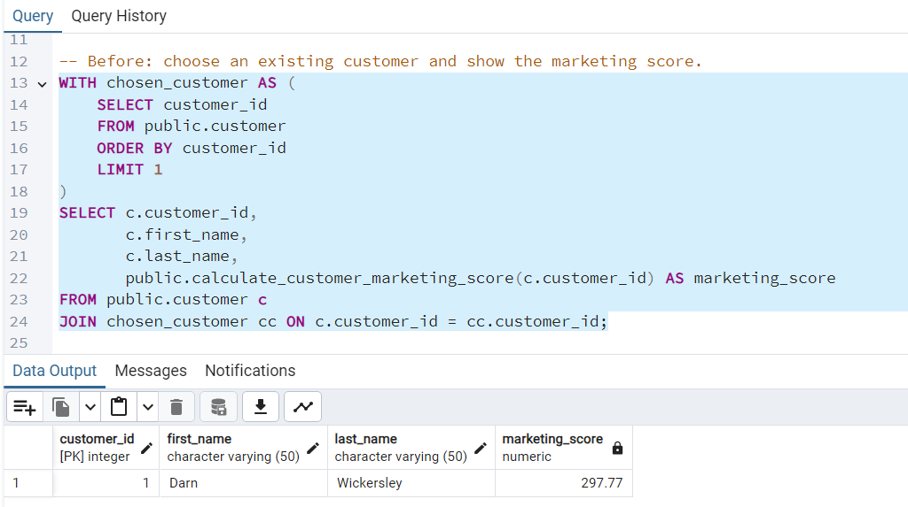

---

## Main Program 2 – Employee Inventory Program

### File

`08_main_program_employee_inventory.sql`

### Description

This main program demonstrates one function and one procedure.

It calls:

* `calculate_employee_bonus`
* `restock_low_inventory`

The program calculates an employee's bonus, creates a low-inventory example for demonstration, and then calls the restock procedure.

The program is wrapped in a transaction and ends with `ROLLBACK` for safe testing.

### SQL Code

```sql
-- 08_main_program_employee_inventory.sql
-- Main Program 2:
--   * Calls one function: calculate_employee_bonus
--   * Calls one procedure: restock_low_inventory
-- Notes:
--   * The program dynamically chooses existing ids from the database.
--   * It is wrapped in a transaction so you can test safely.
--   * For screenshots, run section by section in pgAdmin.

BEGIN;

-- Before: choose an existing employee and calculate bonus.
WITH chosen_employee AS (
    SELECT employee_id
    FROM public.employee
    ORDER BY employee_id
    LIMIT 1
)
SELECT e.employee_id,
       e.first_name,
       e.last_name,
       public.calculate_employee_bonus(e.employee_id) AS calculated_bonus
FROM public.employee e
JOIN chosen_employee ce ON e.employee_id = ce.employee_id;

-- Prepare demo data if no inventory row is currently below minimum stock.
-- This makes the procedure easier to demonstrate.
UPDATE public.inventory i
SET quantity_in_stock = 0
WHERE i.inventory_id = (
    SELECT inventory_id
    FROM public.inventory
    WHERE min_stock_level IS NOT NULL
    ORDER BY inventory_id
    LIMIT 1
);

-- Before restock.
SELECT inventory_id, branch_id, product_id, quantity_in_stock, min_stock_level, last_restock_date
FROM public.inventory
WHERE COALESCE(quantity_in_stock, 0) < COALESCE(min_stock_level, 0)
ORDER BY inventory_id
LIMIT 10;

-- Run procedure: restock low inventory in all branches.
CALL public.restock_low_inventory(NULL, 20);

-- After restock.
SELECT inventory_id, branch_id, product_id, quantity_in_stock, min_stock_level, last_restock_date
FROM public.inventory
ORDER BY last_restock_date DESC NULLS LAST, inventory_id
LIMIT 10;

-- Use COMMIT for real update screenshots, or ROLLBACK for safe testing.
ROLLBACK;
-- COMMIT;
```

### Execution Screenshot

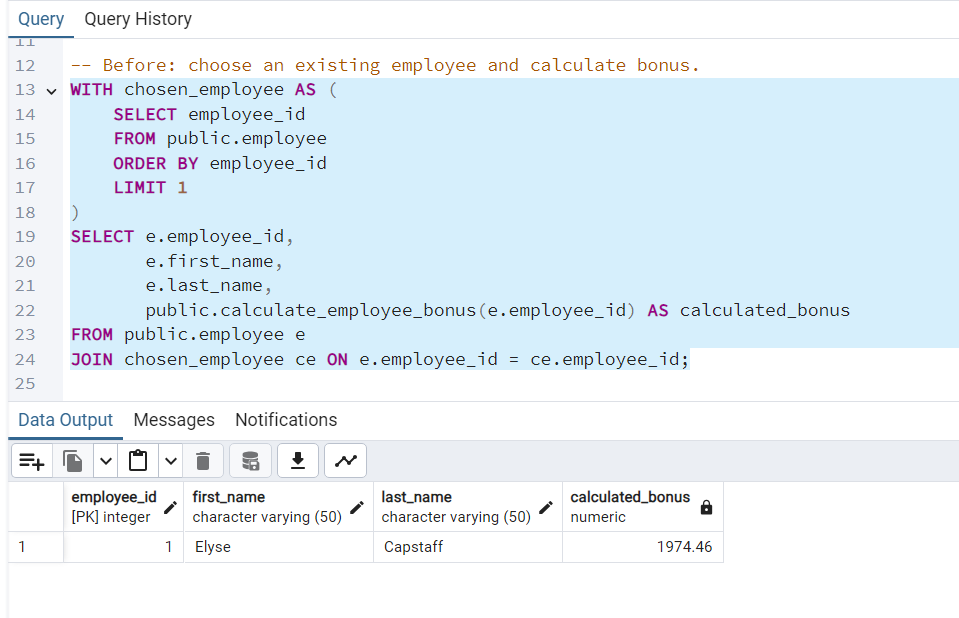

---

## Trigger Demonstration Program

### File

`09_trigger_demo.sql`

### Description

This file demonstrates both triggers together.

It inserts or updates a sale item, causing:

* the validation trigger to calculate the final price
* the inventory trigger to update the product stock automatically

The file is wrapped in a transaction and ends with `ROLLBACK` for safe testing.

### SQL Code

```sql
-- 09_trigger_demo.sql
-- Demonstrates both triggers:
--   * trg_validate_sale_item_before_change
--   * trg_update_inventory_after_sale_item_change
-- Notes:
--   * This file is optional but useful for screenshots in the README.
--   * It is wrapped in a transaction and ends with ROLLBACK for safe testing.

BEGIN;

-- Choose existing sale and inventory records.
-- Show stock before trigger execution.
WITH chosen_inventory AS (
    SELECT inventory_id
    FROM public.inventory
    WHERE COALESCE(quantity_in_stock, 0) >= 5
    ORDER BY inventory_id
    LIMIT 1
)
SELECT inventory_id, quantity_in_stock, min_stock_level
FROM public.inventory
WHERE inventory_id = (SELECT inventory_id FROM chosen_inventory);

-- Insert a valid sale item.
-- Trigger 1 calculates final_price.
-- Trigger 2 subtracts quantity from inventory.
INSERT INTO public.sale_inventory (
    sale_id,
    inventory_id,
    quantity,
    unit_price,
    discount_percent,
    item_status
)
SELECT s.sale_id,
       i.inventory_id,
       1,
       100.00,
       10.00,
       'completed'
FROM public.sale s
CROSS JOIN public.inventory i
WHERE COALESCE(i.quantity_in_stock, 0) >= 5
ORDER BY s.sale_id, i.inventory_id
LIMIT 1
ON CONFLICT (sale_id, inventory_id) DO UPDATE
SET quantity = public.sale_inventory.quantity + 1,
    unit_price = EXCLUDED.unit_price,
    discount_percent = EXCLUDED.discount_percent,
    item_status = EXCLUDED.item_status;

-- Show sale item after validation trigger calculated final_price.
SELECT sale_id, inventory_id, quantity, unit_price, discount_percent, final_price, item_status
FROM public.sale_inventory
ORDER BY sale_id DESC, inventory_id DESC
LIMIT 10;

-- Show stock after inventory trigger.
SELECT inventory_id, quantity_in_stock, min_stock_level
FROM public.inventory
ORDER BY inventory_id
LIMIT 10;

-- Uncomment this block to demonstrate an exception for an invalid discount.
-- DO $$
-- DECLARE
--     v_sale_id INTEGER;
--     v_inventory_id INTEGER;
-- BEGIN
--     SELECT sale_id INTO v_sale_id FROM public.sale ORDER BY sale_id LIMIT 1;
--     SELECT inventory_id INTO v_inventory_id FROM public.inventory WHERE COALESCE(quantity_in_stock, 0) >= 1 ORDER BY inventory_id LIMIT 1;
--
--     INSERT INTO public.sale_inventory (
--         sale_id, inventory_id, quantity, unit_price, discount_percent, item_status
--     )
--     VALUES (v_sale_id, v_inventory_id, 1, 100.00, 80.00, 'completed');
-- END;
-- $$;

ROLLBACK;
```

### Execution Screenshot

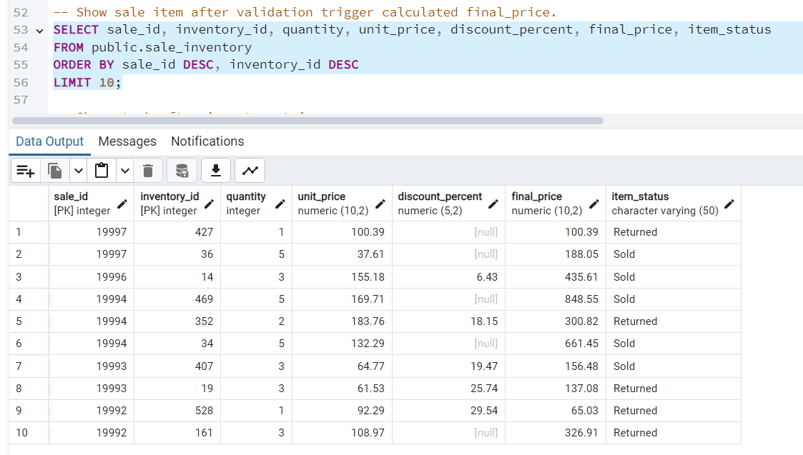

---

# 7. Alter Table File

### File

`AlterTable.sql`

### Description

No schema changes were required for this implementation.

The functions, procedures and triggers use the existing integrated database schema from Stage 3.

### SQL Code

```sql
-- AlterTable.sql
-- No schema changes were required for this Stage 4 implementation.
-- The functions, procedures and triggers use the existing integrated database schema from Stage 3.
```

---

# 8. Stage 4 Files

The following files are included in the Stage 4 submission:

* `01_function_calculate_customer_marketing_score.sql`
* `02_function_calculate_employee_bonus.sql`
* `03_procedure_apply_campaign_discount.sql`
* `04_procedure_restock_low_inventory.sql`
* `05_trigger_validate_sale_item.sql`
* `06_trigger_update_inventory_after_sale_item.sql`
* `07_main_program_customer_campaign.sql`
* `08_main_program_employee_inventory.sql`
* `09_trigger_demo.sql`
* `AlterTable.sql`
* `backup4`

Supporting screenshots are stored in the `images/` directory and are referenced throughout this document.
