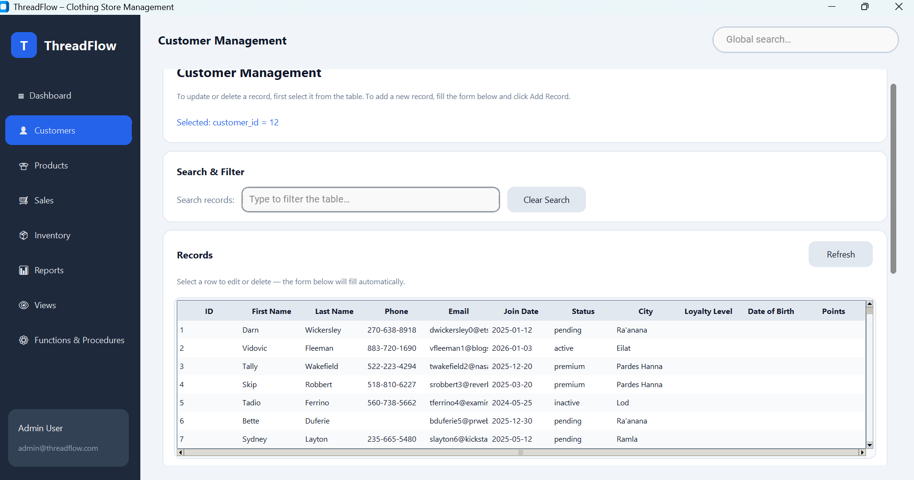
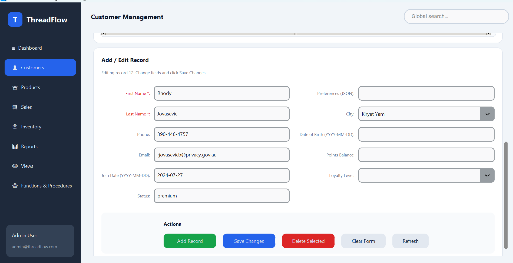
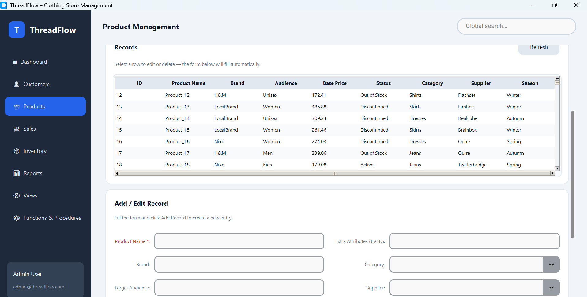
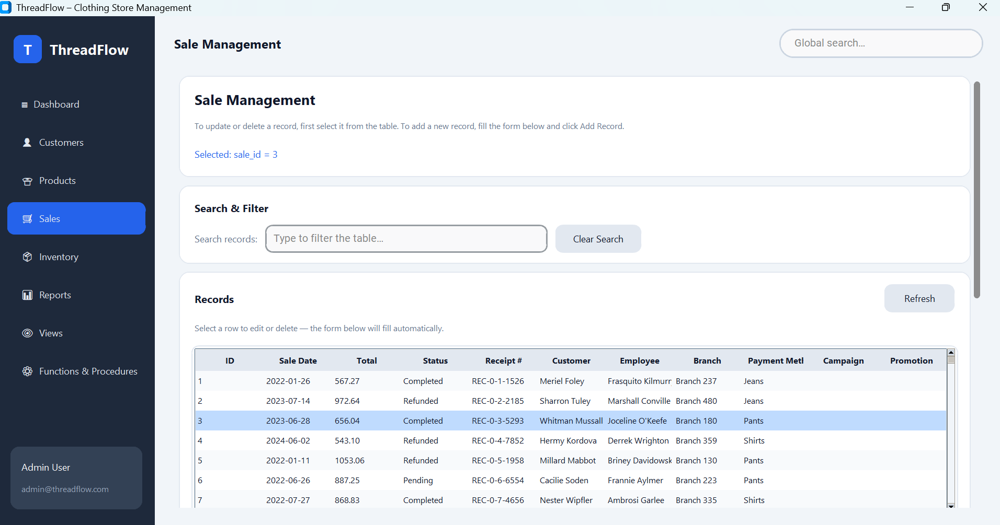
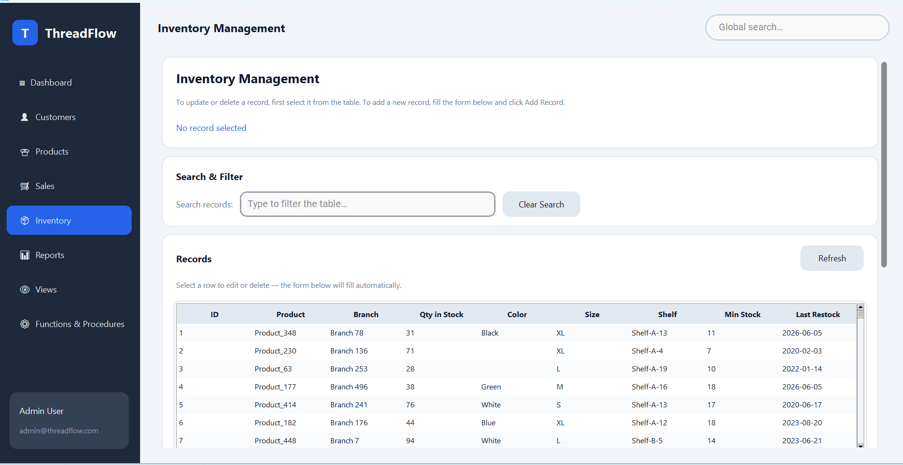
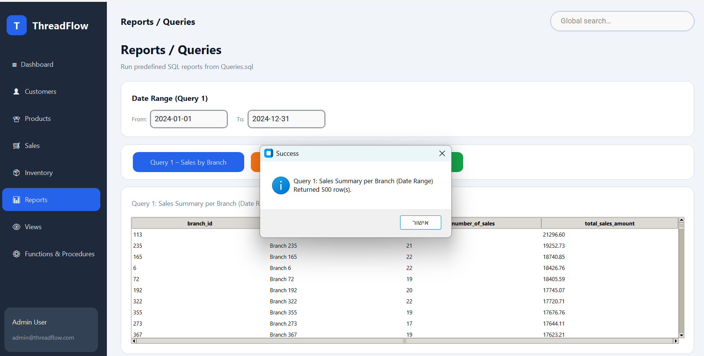
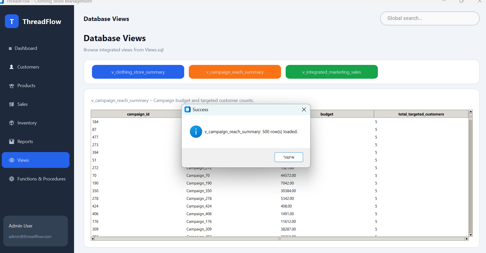
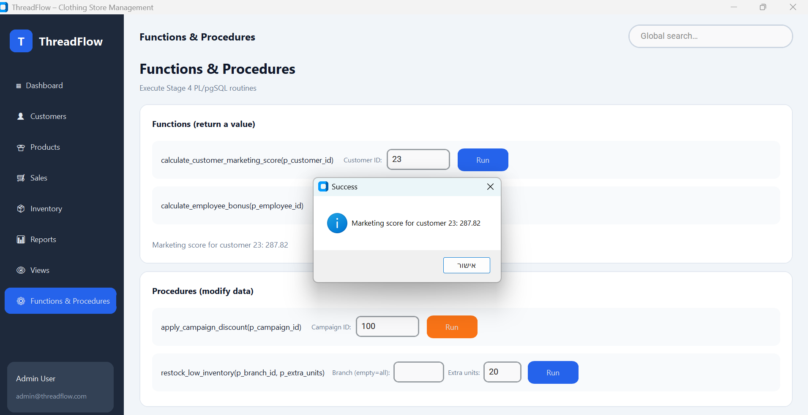
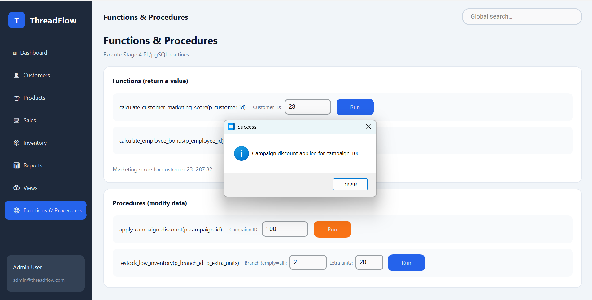
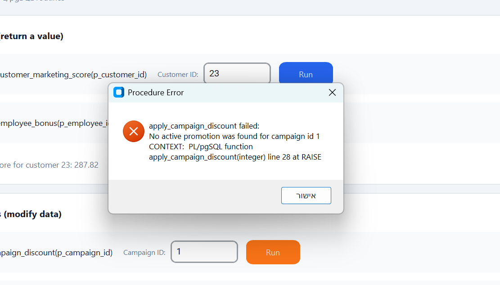

# Stage 5 – Python GUI Application

This stage implements a graphical desktop application for the integrated Clothing Store Database.

The application was developed in Python using CustomTkinter and PostgreSQL. It provides a user-friendly interface for managing database records, executing analytical queries, viewing database views, and running stored functions and procedures developed in previous stages of the project.

The application connects with **psycopg2**, supports CRUD on core tables, runs existing SQL queries and views, and executes Stage 4 functions and procedures.

---

## Prerequisites

- Python 3.10+ (Tkinter is included with standard Python on Windows)
- PostgreSQL with the project database loaded (schema, data, views, functions, procedures from Stages 1–4)
- Dependencies from `requirements.txt` (includes **CustomTkinter** for the modern UI)

---

## Installation

1. Open a terminal in the `stage_5` folder:

```bash
cd stage_5
```

2. Install Python dependencies:

```bash
pip install -r requirements.txt
```

---

## Database Configuration

Edit `config.py` and set your local PostgreSQL connection:

```python
DB_NAME = "clothing_store"
DB_USER = "postgres"
DB_PASSWORD = "your_password"
DB_HOST = "localhost"
DB_PORT = "5432"
```

Ensure the database contains:

- Tables from `createTables_final.sql`
- Views from `stage_3/sql/Views.sql`
- Functions and procedures from `stage_4/sql/`

---

## How to Run

From the `stage_5` directory:

```bash
python main.py
```

On startup, the app tests the database connection and shows a warning if it cannot connect.

---

## Project Structure

```
stage_5/
├── main.py              # CustomTkinter app shell (sidebar + header)
├── config.py            # Database connection settings
├── db.py                # Connection and query helpers (unchanged)
├── requirements.txt
├── screens/
│   ├── ui_theme.py      # Colors, cards, styled buttons/tables
│   ├── dashboard_screen.py  # Dashboard home page
│   ├── crud_config.py   # Table/query definitions for CRUD
│   ├── crud_screen.py   # CRUD screen (modern layout)
│   ├── queries_screen.py
│   ├── views_screen.py
│   └── routines_screen.py
└── README.md
```

---

## GUI Features

### Layout

- **Left sidebar** – navigation to all modules (Dashboard, CRUD, Reports, Views, Routines)
- **Top header** – page title and global search
- **Main content** – scrollable cards and tables

### Dashboard

- KPI cards: Total Customers, Total Products, Total Sales, Low Stock Items
- Recent Sales table
- Quick Actions: Add Customer, Add Product, New Sale, View Reports

### Main Menu

Navigation is via the sidebar (Dashboard replaces the old button menu).

### CRUD Tables

| Screen    | Table      | Foreign keys shown as names                          |
|-----------|------------|------------------------------------------------------|
| Customers | `customer` | city → `city_name`, loyalty → `level_name`           |
| Products  | `product`  | category, supplier, season names                     |
| Sales     | `sale`     | customer/employee full name, branch, payment, campaign, promo |
| Inventory | `inventory`| product name, branch name                            |

Each CRUD screen supports:

- View all records in a table (Treeview)
- **Add New** – insert without entering PK (auto-generated)
- **Load for Update** –- Select a row from the table
- Load the selected record into the form
- Edit values
- Save Changes
- **Delete** – by PK (with confirmation)
- **Refresh** – reload data from database
- Click a row to fill the PK field

### Reports / Queries

Runs queries from `stage_2/sql/Queries.sql`:

| Button | Query | Notes |
|--------|-------|-------|
| Query 1 | Sales Summary per Branch in a Date Range | Uses From/To date fields |
| Query 2 | Best-Selling Products by Quantity | — |
| Query 5 | Low Inventory Report for Goods Order | — |

### Database Views

Displays views from `stage_3/sql/Views.sql`:

- `v_clothing_store_summary`
- `v_campaign_reach_summary`
- `v_integrated_marketing_sales`

### Functions & Procedures

Stage 4 routines from `stage_4/sql/`:

| Routine | Parameters | Result |
|---------|------------|--------|
| `calculate_customer_marketing_score` | customer ID | Numeric score |
| `calculate_employee_bonus` | employee ID | Numeric bonus |
| `apply_campaign_discount` | campaign ID | Updates sale/sale_inventory |
| `restock_low_inventory` | branch ID (optional), extra units | Updates inventory |

After procedures run, **sale** and **inventory** CRUD screens refresh automatically when re-opened.

---

## Error Handling

- Database errors show popup messages
- Failed writes roll back the transaction
- Successful inserts/updates/deletes/procedures commit explicitly

---

## Screenshots for Submission

### Main Menu


### Customers CRUD

Customer table screen:



Customer add/edit form:



### Products CRUD



### Sales CRUD



### Inventory CRUD



### Reports / Queries



### Database Views



### Function Execution



### Procedure Execution



### Error Handling



---

## Troubleshooting

| Problem | Solution |
|---------|----------|
| Connection failed | Check `config.py`, PostgreSQL service, database name |
| View/function not found | Run `Views.sql` and Stage 4 SQL scripts on the database |
| FK error on insert | Choose valid values from dropdowns |
| Delete blocked | Row may be referenced by other tables (FK constraint) |
