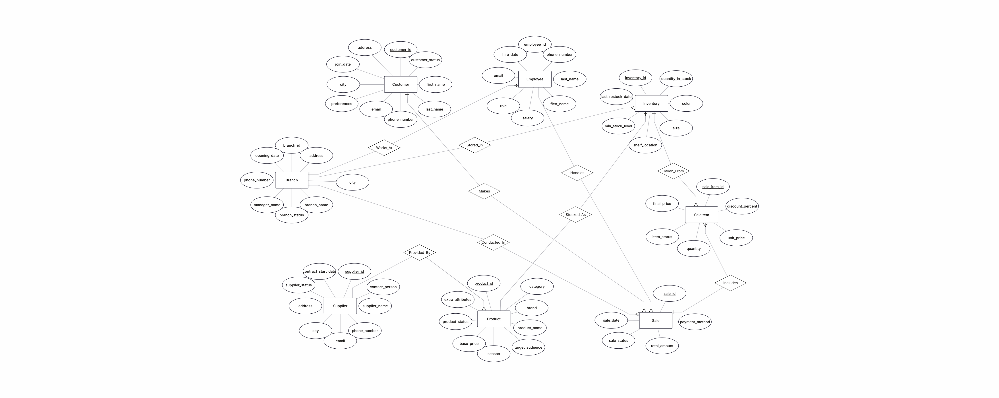

# Database Mini Project – Clothing Store Management System

Mini-project for the **Database Systems course**.

This project designs and implements a database system for managing a clothing retail chain, including sales, inventory, products, customers, employees, suppliers, and branches.

The repository documents all stages of the system analysis, database design, implementation, data population, and backup process.

---

# Project Team

- Hila Miller
- Hila Rosental

Institution: Jerusalem College of Technology (JCT)

---

# Table of Contents

## Stage 1 – Information System Design
1. System Analysis (Top-Down)
2. UI Mockups
3. ERD – Entity Relationship Diagram
4. Relational Schema & DSD
5. Normalization & Functional Dependencies
6. Database Implementation
7. Data Population
8. Backup & Recovery

(Future stages will be added later)

---

# Stage 1 – Information System Design

## 1. System Analysis (Top-Down)

(To be completed)

This section will describe the system requirements and define the system boundaries using a top-down analysis approach.

---

## 2. UI Mockups (Google AI Studio)

(To be completed)

Planned system screens will be designed using Google AI Studio in order to demonstrate the future system interface and user flow.

Screenshots will be added in this section.

---

## 3. ERD – Entity Relationship Diagram

The database design was created using **ERDPlus**.

The ERD models the main entities of a clothing retail management system and the relationships between them.

Main entities include:

- Branch
- Employee
- Customer
- Supplier
- Product
- Inventory
- Sale
- SaleItem

Each entity contains at least five attributes according to the project requirements.

Relationships include:

- Branch employs Employees
- Branch records Sales
- Branch stores Inventory
- Supplier supplies Products
- Product appears in Inventory
- Customer makes Sales
- Employee handles Sales
- Sale contains SaleItems
- SaleItem references Inventory

Cardinality constraints were defined for all relationships.

### ERD Diagram

---

## 4. Relational Schema & DSD

(To be completed)

The ERD will be translated into a relational schema and implemented in PostgreSQL.  
A **Data Structure Diagram (DSD)** representing the physical schema will be added.

---

## 5. Normalization & Functional Dependencies

(To be completed)

Each relation will be analyzed for functional dependencies and normalized to **3NF / BCNF**.

---

## 6. Database Implementation

(To be completed)

The relational schema will be implemented using **PostgreSQL (pgAdmin)**.

---

## 7. Data Population

(To be completed)

The database will be populated using several methods including Python scripts, external data generation tools, and CSV/Excel imports.

---

## 8. Backup & Recovery

(To be completed)

A full backup of the database will be created to allow complete system restoration including both structure and data.

---

# Stage 2 – (To be added later)

This section will be added when Stage 2 of the project begins.
